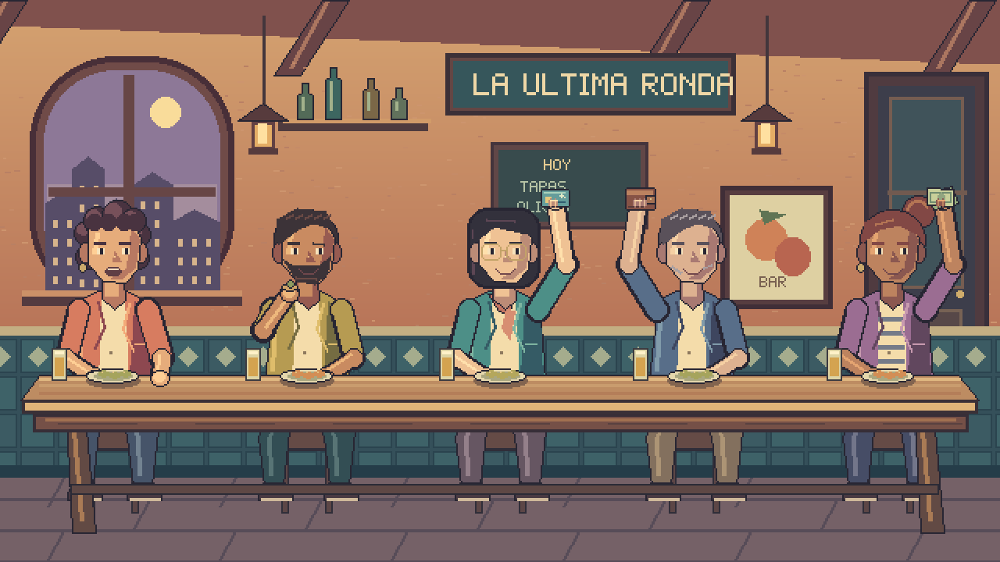
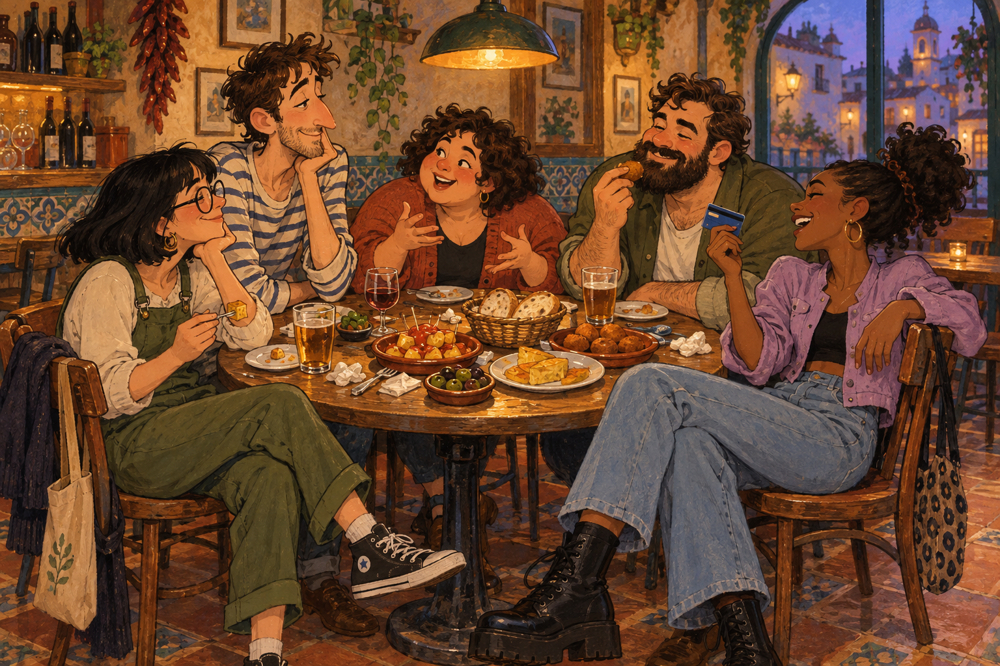
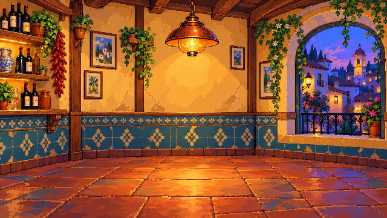

# Spanish Simulator

> **🎮 [Abrir la demo pública: La última ronda](https://spanish-simulator-ultima-ronda.ivanra.chatgpt.site)**
>
> Prueba de la taberna con cinco personajes animados por separado. Pulsa **«Escena de prueba»** para ver charla, comida y pago con tarjeta, cartera y billetes. Se abre en el navegador sin instalar nada. Es un ensayo gráfico; el minijuego completo y el camarero están pendientes.

Juego con estética **pixel art** compuesto por **minijuegos conectados entre sí sobre tópicos españoles**. Se desarrollará entre dos personas con ayuda de IA.

## Equipo

| Persona | Alias | Referencia en estas conversaciones |
| --- | --- | --- |
| **Ivan R** | **kapichu** | El usuario de este chat. |
| **Ivan S** | **Alcachofo** | El otro integrante del proyecto. |

Usaremos estos nombres y alias para identificar quién propone, confirma o asume una tarea. Los roles y el reparto de trabajo todavía no están acordados.

Algunos o todos los minijuegos podrán jugarse colaborativamente: una pantalla compartida muestra la partida y los jugadores conectan sus móviles mediante un código QR para utilizarlos como mandos. El reparto exacto entre modos cooperativos, competitivos o mixtos está pendiente de decidir.

Este repositorio reúne el concepto, las decisiones y la investigación para producir el juego. Se priorizan una estética atractiva y coherente, buenas animaciones, rendimiento y un proceso eficaz de creación con IA. El ahorro de espacio al estilo de las máquinas antiguas no es la prioridad.

## Primer minijuego: Pagar la cuenta

El primer concepto ya está disponible en [este prototipo de Pagar la cuenta](https://spanish-simulator.salmeinmotion.com/).

En una revisión inicial realizada el 23 de octubre de 2026 se observó una sala con QR y código de acceso, lista de jugadores e instrucciones para usar el móvil como mando: tocar para ofrecer el pago y deslizar al lado contrario del camarero para esquivar. No se ha probado una partida multijugador completa ni auditado su implementación. La tecnología del prototipo no se da por elegida para el juego definitivo y su aspecto no fija todavía la dirección artística final.

## Primera prueba funcional de gráficos

Se ha construido [La última ronda, una demo pública de la taberna](https://spanish-simulator-ultima-ronda.ivanra.chatgpt.site), con [código, originales e instrucciones](prototipos/taberna/README.md): cinco personajes con sus propios relojes, reposo, charla, un bocado sencillo y pago con tarjeta, cartera o billetes. Se puede pausar un actor mientras los otros siguen, sostener la oferta y cancelarla a mitad de la subida. El camarero queda fuera.

El dibujo original está programado con Pillow y se ha importado, montado, etiquetado, auditado y exportado mediante llamadas reales a Aseprite MCP. Se incluyen los originales `.aseprite`, hojas PNG, metadatos, generador y visor. La revisión artística del equipo sigue pendiente; crear esta muestra no fija el estilo ni cierra las decisiones principales.

Para probarla, clonar o descargar el repositorio y abrir `prototipos/taberna/index.html` o `ABRIR.bat`. Funciona sin instalar paquetes ni arrancar un servidor. Es un compositor de prueba, sin salas, mandos móviles ni reglas completas del minijuego.

## Nueva exploración visual: mesa redonda

Tras revisar la demo, kapichu señaló pelo que parece flotar, piernas repetidas, diseños rígidos y contornos visibles en las uniones de los brazos. Pidió empezar por un boceto: amigos alrededor de una mesa redonda, diseños más variados y un ambiente más cálido y expresivo.

Este [boceto de concepto y su encargo](arte/conceptos/mesa-redonda-v01/README.md) explora esa dirección. Está generado como ilustración, todavía sin convertir a pixel art ni animar, y pendiente de valoración. La demo anterior sigue disponible como prueba técnica.

kapichu ha valorado positivamente el boceto como arte conceptual y pide conservar su ambiente en gráficos simplificados. El [recorrido propuesto hasta una escena jugable](docs/del-concepto-a-jugable.md) empieza por dos versiones estáticas al tamaño de juego, comprueba las poses de pago alrededor de la mesa y valida un personaje animado antes de producir los cinco. El acabado definitivo sigue pendiente de acordar.

Ya están disponibles [dos tratamientos simplificados, A más plano y B con más volumen](arte/conceptos/mesa-redonda-v02/README.md), junto con un visor local de comparación a 640×360. Son pruebas de aspecto generadas; todavía no son sprites separados ni pixel art con cuadrícula y paleta verificadas. Su selección sigue pendiente.

**Fondo independiente, revisión actual:** [taberna v02](arte/escenarios/taberna-v02/README.md), con PNG a 640×360, ampliación a 2× y original `.aseprite`. Recupera iluminación, volumen y materiales; mesa y personajes siguen separados. Se ha generado el arte y preparado mediante Aseprite MCP en RGB, sin forzar una paleta pequeña. Ivan R descartó el primer fondo por su simplificación excesiva; esta revisión está pendiente de valoración.

## Decisiones que necesitamos tomar

**Progreso de acuerdos: 0 de 22 decisiones cerradas · 0 %**

`[░░░░░░░░░░░░░░░░░░░░] 0 %`

El contador mide las decisiones de las dos tablas siguientes, no el desarrollo del juego. El nombre, el concepto, la estética pixel art y la existencia del prototipo ya están confirmados y quedan fuera de este contador. Todas las decisiones de detalle empiezan pendientes, al 0 %.

- **Pendiente:** todavía sin elección; 0 %.
- **En conversación:** hay alternativas o acuerdos parciales, pero el punto sigue abierto; 0 % de cierre.
- **Acordada:** elección explícita registrada, con su motivo y quién la confirma; 100 %.

El progreso global es `decisiones acordadas / decisiones totales × 100`. Cada punto pesa lo mismo. Abrir una conversación o investigar una alternativa no aumenta el porcentaje de acuerdos.

Los identificadores **01–22 son estables**: podemos decir «vamos con el 08» o «revisemos el 17». Si añadimos decisiones, usaremos números nuevos sin renumerar las existentes. Si dividimos un punto, sus subpuntos usarán referencias como `08.1`; el punto principal contará una sola vez y se cerrará cuando su alcance esté resuelto. Los nuevos puntos principales cambiarán el denominador y se dejará constancia.

| Nº | Área | Qué debemos concretar | Estado | Cierre |
| --- | --- | --- | --- | --- |
| 01 | Experiencia y público | A quién va dirigido, tono del humor y tratamiento de los tópicos; duración de una sesión, dificultad y motivos para volver a jugar. | Pendiente | 0 % |
| 02 | Minijuegos y conexión | Catálogo inicial, reglas y objetivos; cómo se pasa de uno a otro y qué comparten: personajes, puntuación, historia, economía o progresión. Definir alcance de la primera versión. | En conversación | 0 % |
| 03 | Modos de juego | Qué minijuegos son cooperativos, competitivos o mixtos; mínimo y máximo de jugadores, posibilidad de jugar solo, sustitución de ausentes y participación de espectadores. | Pendiente | 0 % |
| 04 | Plataformas y distribución | Dónde funciona la pantalla principal: navegador, ordenador, televisión, consola u otra opción; si requiere instalación y cómo se distribuye. Elegir una primera plataforma antes de ampliar. | Pendiente | 0 % |
| 05 | Dispositivos y controles | Móviles, sistemas y navegadores compatibles; orientación, tamaño de botones, gestos y respuesta táctil. Decidir alternativas con teclado o mando, y qué ocurre si alguien no tiene móvil. | Pendiente | 0 % |
| 06 | Tecnología y arquitectura | Motor o tecnología del juego y de los mandos; comunicación en tiempo real, autoridad sobre el estado de partida, reutilización entre minijuegos y herramientas de desarrollo. Comprobar qué conviene conservar del prototipo. | Pendiente | 0 % |
| 07 | Salas y conexión | Creación de sala, acceso por QR y código manual, quién inicia y pausa; misma Wi-Fi o acceso por Internet, incorporación tardía, desconexión/reconexión, latencia, sincronización y caducidad de salas. | Pendiente | 0 % |
| 08 | Dirección artística | Perspectiva, resolución base, escalado, paleta, iluminación, contornos, proporciones y nivel de detalle. Definir cómo se relacionan fondos, personajes, objetos e interfaz. | En conversación | 0 % |
| 09 | Personajes | Elenco, personalidad, función en los minijuegos, siluetas, vestuario, expresiones y personalización. Decidir qué vistas, poses y animaciones necesita cada uno. | En conversación | 0 % |
| 10 | Animación y audio | Tipo y ritmo de animación, prioridades y reutilización; música, efectos, posibles voces, identidad sonora, controles de volumen y procedencia de los recursos. | En conversación | 0 % |
| 11 | Textos e idiomas | Voz del juego, humor, nombres y terminología; idiomas iniciales, traducción de referencias culturales, fuentes y espacio para textos de distinta longitud. | Pendiente | 0 % |
| 12 | Usabilidad y accesibilidad | Legibilidad a distancia en la pantalla y en el móvil, contraste, señales que no dependan solo del color, subtítulos, aprendizaje de controles y opciones para distintos ritmos o capacidades. | Pendiente | 0 % |
| 13 | Rendimiento y calidad | Dispositivos mínimos, fluidez y tiempos de carga; respuesta de los mandos, presupuesto de gráficos/efectos y pruebas con varios móviles y conexiones reales. | Pendiente | 0 % |
| 14 | Operación y datos | Alojamiento y coste recurrente; si hacen falta cuentas o bastan invitados, qué progreso se guarda, duración de las sesiones y mantenimiento tras publicar. | Pendiente | 0 % |
| 15 | Trabajo conjunto y alcance | Reparto de tareas y decisiones, revisión de cambios, organización de archivos, criterios para dar algo por terminado y tamaño de la primera versión jugable. | Pendiente | 0 % |

## Cómo crear los gráficos con IA

Necesitamos encontrar un método que produzca recursos **bonitos, coherentes, editables y fáciles de animar**, con un coste razonable de tiempo, tokens y revisiones. Las herramientas disponibles no garantizan por sí solas esa calidad.

Estas decisiones continúan la numeración anterior y también cuentan para el progreso global. La elección artística del 08 y el elenco del 09 se distinguen de cómo documentaremos y produciremos sus recursos en los puntos 16–22.

| Nº | Decisión | Qué debemos concretar | Estado | Cierre |
| --- | --- | --- | --- | --- |
| 16 | Guía visual común | Si la usamos, su formato y contenido: referencias aprobadas, paleta, proporciones, luz, contornos, perspectiva, tipografía, interfaz y ejemplos de lo que encaja y lo que queremos evitar. | En conversación | 0 % |
| 17 | Fichas de personaje | Formato y detalle útil para personas e IA: diseño base, silueta, colores, vestuario, vistas, expresiones, poses y rasgos que deben mantenerse al animar. | En conversación | 0 % |
| 18 | Recursos maestros y piezas reutilizables | Qué biblioteca aprobada de personajes, objetos y componentes de interfaz necesitamos y cómo derivar variantes. | En conversación | 0 % |
| 19 | Proceso por etapas | Cómo pasamos por referencia y silueta, colores, sombras, detalles y animación; en qué momentos revisamos al tamaño real y dentro del juego. | En conversación | 0 % |
| 20 | Métodos y aprendizaje | Qué tareas compararemos con MCP, Lua, Pillow y generación de imágenes; cómo investigar buenas prácticas y elegir métodos a partir de pruebas. | En conversación | 0 % |
| 21 | Medición y presupuesto de eficiencia | Límites y criterios de tiempo, tokens/coste, llamadas, revisiones y retoque manual; cómo evaluar calidad, coherencia y facilidad de corrección. | En conversación | 0 % |
| 22 | Entrega reproducible | Originales editables, capas, etiquetas, puntos de apoyo, nombres, exportación para el motor y validación de cada entrega. | En conversación | 0 % |

No están decididos el tamaño de los sprites, el número de colores ni los fotogramas. Las cifras mencionadas en conversaciones anteriores son ejemplos para pruebas.

### Investigación sobre la escena actual

La [investigación de producción gráfica de Pagar la cuenta](docs/investigacion-graficos.md) propone separar el fondo limpio, los personajes, la mesa y otros elementos que ocultan, los objetos móviles y la interfaz. Cada recurso se diseña dentro de una composición común; la recomendación todavía no es un acuerdo del equipo.

Se compararon 20 operaciones simples con el MCP local: mediana de **5,476 s** en llamadas individuales frente a **0,263 s** en un lote Lua, con píxeles idénticos. Es una prueba de ejecución repetitiva; no mide calidad artística ni ahorro de tokens. El documento recoge las fuentes, alternativas y límites de la medición.

Los puntos **02, 08, 09, 10 y 16–22** están **En conversación**. El progreso continúa en **0/22 (0 %)** porque todavía no se ha cerrado ninguna decisión principal. Hay requisitos parciales de la muestra confirmados por Ivan R, registrados por separado para no perderlos.

### Plan de la escena de taberna

El [plan de producción con Aseprite MCP](docs/plan-escena-taberna.md) propone una taberna con un acabado de cómic, personajes expresivos y fondo menos dominante. El acabado y las dimensiones son propuestas pendientes de validar.

Ivan R ha pedido que los personajes se animen de forma independiente, puedan charlar y levanten la mano para pagar con cartera, tarjeta o billetes. Comer es una posibilidad posterior. **El camarero se incorporará más adelante y queda fuera de la muestra inicial.**

La producción propuesta empieza con una composición de cinco plazas y un personaje piloto; comprueba reposo, charla y pago antes de extenderlo al resto del elenco. La primera muestra ya se ha implementado con clips y relojes por actor y orden de mesa, brazo, objeto y dedos. El plan conserva la propuesta de trabajo; el resultado, sus comprobaciones y límites están en el [prototipo](prototipos/taberna/README.md).

## Referencia de estudio: recursos SCUMM

Ivan S (Alcachofo) ha creado una [herramienta de exploración de recursos SCUMM, enlazada a Day of the Tentacle, sala 7](https://scumm.rea.salmeinmotion.com/dott/#room=7). El visor permite consultar escenarios y objetos en contexto y dispone de secciones de personajes, animaciones, música y sonidos.

La idea es **aprender e inspirarnos, creando recursos originales para Spanish Simulator**. Podemos estudiar composición, jerarquía visual, paletas, proporciones, separación de fondos y objetos, reutilización de piezas y ritmo de animación. No se busca copiar ni incorporar los recursos extraídos al juego. Su uso como referencia no implica haber elegido el estilo de Day of the Tentacle.

## Orden de trabajo propuesto

1. Acordar público, experiencia de juego y alcance de la primera versión, usando Pagar la cuenta como caso inicial.
2. Elegir plataformas iniciales y validar el recorrido pantalla–QR–móvil con varios jugadores, incluida la reconexión; comparar tecnologías con esa necesidad concreta.
3. Explorar unas pocas direcciones visuales en una pantalla representativa y aprobar una antes de producir el resto de recursos.
4. Crear una guía visual y una primera ficha de personaje; comparar métodos de producción de un mismo recurso estático y animado, midiendo calidad y esfuerzo.
5. Completar una versión pequeña de Pagar la cuenta, probarla con personas y usar lo aprendido para decidir qué elementos compartirán los siguientes minijuegos.

Este orden es una propuesta, pendiente de acordar entre los dos responsables.

## Mantener el contexto compartido

Por indicación del usuario, iremos resumiendo y subiendo a GitHub el contexto relevante y los acuerdos de las conversaciones. Las propuestas se identificarán como tales. Las conversaciones privadas no se sincronizan automáticamente ni hace falta publicar transcripciones completas.

Para cada decisión importante anotaremos su número estable, pregunta, alternativas, estado, elección y motivo cuando se resuelva, quién la propone o confirma, responsable y una prueba o referencia si la necesita. Actualizaremos las tablas y la barra de este README y el [registro de decisiones](docs/decisiones.md). Una decisión reabierta vuelve a contar como abierta; conservaremos el motivo del cambio.

## Documentación y estado del repositorio

- [AGENTS.md](AGENTS.md): instrucciones para las IA, incluida la pauta de mantener el contexto publicado.
- [Contexto y decisiones](docs/decisiones.md): acuerdos confirmados y cuestiones pendientes.
- [Dirección artística](docs/arte.md): recomendaciones de pixel art, animación y producción con IA.
- [Investigación de gráficos de Pagar la cuenta](docs/investigacion-graficos.md): separación de la escena, métodos de creación y medición local de operaciones por lotes.
- [Plan de la escena de taberna](docs/plan-escena-taberna.md): producción con MCP, personajes independientes, charla y pago con distintos objetos; camarero aplazado.
- [Colaboración](docs/colaboracion.md): organización del trabajo entre dos personas y sus asistentes.
- [Laboratorio local](docs/laboratorio.md): Aseprite, MCP, visor y experimentos gráficos recuperados.

Este repositorio contiene planificación, documentación y la prueba local de gráficos. El prototipo multijugador original sigue en el enlace externo; su código, las herramientas instaladas y los gráficos de los experimentos antiguos del laboratorio no se han incorporado.

Para incorporarse con una IA, pedirle que lea primero AGENTS.md y los documentos que correspondan a su tarea. No todas las herramientas cargan automáticamente los mismos archivos.
