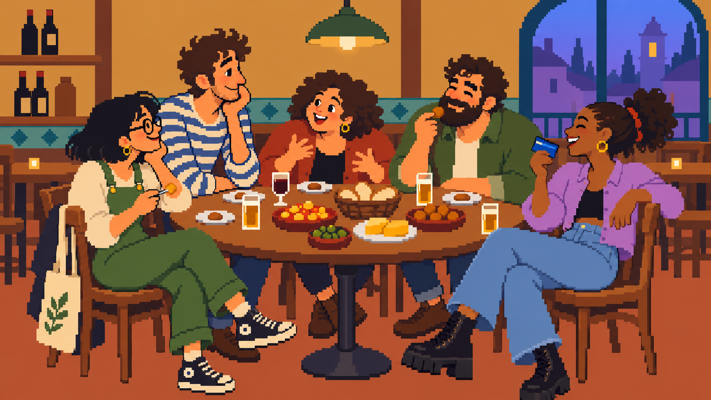
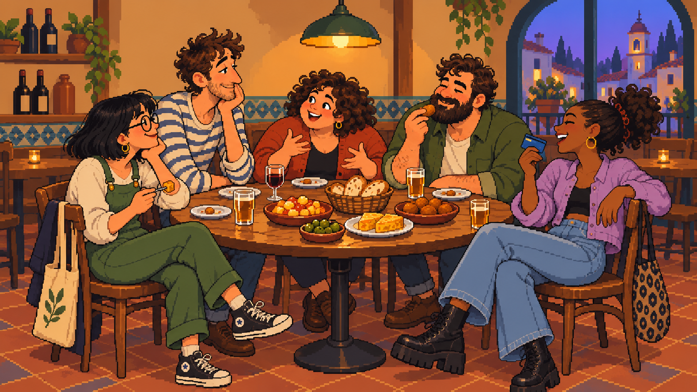

# Dos tratamientos simplificados de la mesa redonda

23 de octubre de 2026. Primera entrega estática del [recorrido propuesto](../../../docs/del-concepto-a-jugable.md), ejecutada a petición de Ivan R. Pendiente de valoración del equipo; no se cierran decisiones artísticas.

Abrir `index.html` para comparar a 640×360, alternando A y B o mostrando ambas. Funciona localmente sin paquetes ni servidor. El lienzo ajusta cada imagen con nearest y conserva su proporción; las imágenes fuente no se han reducido ni alterado después de la generación. El visor presenta un tamaño de juego, no certifica una cuadrícula nativa.

Se ha comprobado en el navegador la carga de ambas imágenes y la alternancia A/B, sin errores de consola. [Captura del comparador](captura-comparador.png).

## A · Más plana

Reduce texturas, decoración, mechones y detalle de comida/ropa. Conserva los cinco amigos, sus gestos, la mesa redonda y el contraste cálido/frío. [Prompt utilizado](prompt-a-plano.txt).

## B · Más volumen

Conserva más sombras, detalles de materiales y decoración. Se produjo primero, buscando una imagen plana, pero el resultado mantuvo demasiado detalle para esa categoría. Se conserva como variante con volumen y sirvió de referencia para simplificar A. [Prompt original](prompt-b-volumen.txt).

## Producción y límites

Ambas creadas con la herramienta integrada de generación de imágenes. B toma el [boceto anterior](../mesa-redonda-v01/boceto.png) como referencia y A modifica B para conservar una composición comparable. No son dos fotogramas registrados ni copias geométricamente idénticas: hay pequeñas variaciones de dibujo y encuadre.

| Archivo | Tamaño generado | Colores RGB distintos |
| --- | --- | --- |
| A | 1671×941 | 202709 |
| B | 1672×941 | 335646 |

El modelo no respetó una paleta de 24–32 colores ni una cuadrícula exacta. Los valores RGB y los degradados residuales lo confirman: la apariencia pixelada no equivale a sprites listos para producción. No se aplica una reducción automática y se presenta como si fuera un redibujo. A es relativamente más plana, pero aún conserva sombras y gradaciones que habría que resolver en el original de juego.

La comparación a 640×360 permite comprobar rostros, tarjeta y siluetas en un marco representativo. La textura de B pierde presencia al reducirse; A conserva formas más grandes y menos ruido. La selección del equipo sigue pendiente. En ambas habrá que revisar la mano de pago, el espacio libre para futuras poses y las superposiciones de las plazas delanteras.

No hay todavía capas, fondo reconstruido detrás de personajes, originales Aseprite nuevos, animación ni reglas de juego. El MCP no se ha utilizado en estas dos imágenes. La demo pública anterior sigue siendo la prueba técnica independiente.

## Próximo trabajo propuesto

Tras valorar la simplificación, preparar una pantalla con cuadrícula coherente y recursos separados. Ensayar poses de pago provisionales en las cinco plazas y terminar un personaje con torso/brazo continuos antes de extenderlo al resto. No generar cinco animaciones completas sobre imágenes aún no elegidas.
