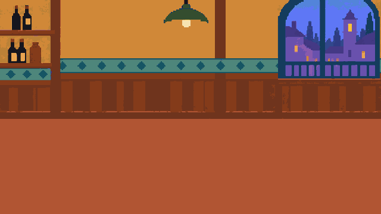

# Taberna: primer fondo independiente

23 de octubre de 2026. Producido a petición de Ivan R (kapichu) para empezar por el fondo y después incorporar mesa y personajes separados. Es una primera versión pendiente de valoración, no la aprobación definitiva de la dirección artística.



## Recurso utilizable

- [fondo.png](fondo.png): 640×360 píxeles, opaco y 30 colores RGB visibles. Escalar con nearest y preferiblemente múltiplos enteros.
- [fondo.aseprite](fondo.aseprite): original editable indexado, un fotograma y dos capas: `arquitectura` y `suelo_limpio`. La arquitectura no está desglosada en objetos individuales.
- [Fuente generada](fuentes/fondo-generado.png) y [prompt completo](fuentes/prompt.txt).
- [Registro de preparación y validación por MCP](produccion-mcp.json).

Se conserva la estantería de botellas a la izquierda, pared ocre, franja de azulejos teal, lámpara verde y ventana de atardecer frío a la derecha. No contiene personajes, mesa, sillas, comida ni sombras de esos elementos. La zona central e inferior queda disponible para componerlos después. La mesa y las sillas no deben incorporarse permanentemente a este fondo si necesitan superposiciones con los actores.

## Método real

La herramienta integrada de generación de imágenes produjo la taberna vacía usando como referencia el tratamiento simplificado A. Esto no supone que Ivan R haya elegido A como estilo final. El archivo generado no tenía por sí solo una cuadrícula ni una paleta listas para el juego.

Después se preparó en Aseprite mediante cuatro llamadas MCP por ejecución: Lua para redimensionar a 640×360 con nearest, limpiar selectivamente los tonos de la pared, crear un suelo plano en capa separada, generar una paleta de hasta 32 colores, convertir sin dithering y reducir píxeles aislados; exportación PNG; inspección del original; lectura de paleta. El resultado es un fondo derivado de generación con limpieza programada, no un dibujo realizado íntegramente a mano píxel a píxel. La reducción de colores no equivale por sí misma a calidad artística.

Se ha inspeccionado la imagen exportada. Se verificaron tamaño, opacidad completa, un fotograma, dos capas, modo indexado y 30 colores RGB realmente utilizados. Quedan zonas con detalle residual, principalmente estantería y madera; valorar su lectura junto al primer personaje antes de pulirlas más. La coherencia de la cuadrícula y el acabado de los contornos requieren revisión visual, además de estas comprobaciones técnicas.

## Reproducir

Desde la raíz del repositorio, con el laboratorio local y su `.mcp.json` preparados:

```powershell
& '.\aseprite-mcp\.venv\Scripts\python.exe' '.\arte\escenarios\taberna-v01\preparar.py'
```

Python coordina las llamadas MCP y lee el PNG con Pillow para verificarlo; las operaciones de preparación de imagen se ejecutan en Aseprite. No requiere generar de nuevo la imagen: usa la fuente guardada. Las dimensiones y las máscaras de limpieza corresponden a esta versión y deberán revisarse si cambia la fuente.

## Siguiente paso propuesto

Comprobar una mesa redonda y cinco siluetas provisionales sobre este fondo para fijar plazas y recorridos de brazos. Después preparar un personaje independiente y probar sus poses de pago antes de producir el resto. No se han creado esos recursos en esta entrega.
