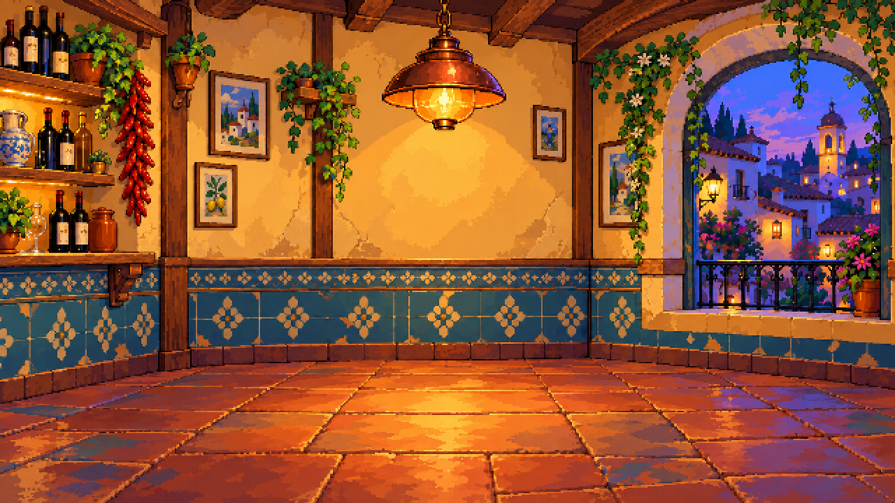

# Fondo de taberna v02: conservar luz y volumen

23 de octubre de 2026. Revisión solicitada por Ivan R tras rechazar el fondo v01 por su simplificación excesiva y la lámpara. Esta versión sustituye a v01 como propuesta actual; su aprobación artística sigue pendiente del equipo.

Ivan R ha valorado positivamente esta revisión y ha pedido trasladar el mismo lenguaje visual a otros recursos. La [primera mesa independiente y su montaje](../../objetos/mesa-redonda-v01/README.md) permiten comprobarlo. No se atribuye esa valoración a Ivan S ni se considera cerrada la dirección artística global.



## Archivos para revisar y usar

- [fondo.png](fondo.png): versión de 640×360, opaca, RGB, sin restricción artificial de paleta.
- [vista-2x.png](vista-2x.png): ampliación exacta a 1280×720 con nearest; cada píxel original forma un bloque 2×2.
- [fondo.aseprite](fondo.aseprite): un fotograma y una capa RGB `fondo_compuesto`. Editable como imagen; los objetos de la arquitectura no están separados en capas.
- [Primera propuesta con textura más densa](fuentes/01-diseno.png) y [fuente tras reducir microtextura](fuentes/02-textura-controlada.png).
- Prompts de [diseño](fuentes/prompt-01.txt) y [revisión de textura](fuentes/prompt-02.txt).
- [preparar.py](preparar.py) y [produccion-mcp.json](produccion-mcp.json): preparación reproducible y comprobaciones.

La taberna está vacía: mesa, sillas y personajes se compondrán como recursos separados. Se ha rediseñado la lámpara en cobre y cristal ámbar, conservado la profundidad del arco, el zócalo cerámico y las juntas del suelo, y organizado la escena con luz cálida central y sombras frías alrededor de la ventana. Las zonas de mayor decoración se concentran en los bordes; habrá que comprobar su contraste con el futuro elenco.

## Cambio de método

El fondo anterior perdió carácter por dos decisiones del asistente: exigir colores casi planos en la generación y después sobrescribir pared/suelo y forzar una paleta pequeña. Esas operaciones no son una definición de pixel art ni estaban justificadas por restricciones del juego. V01 se conserva como ejemplo descartado, no como referencia a imitar.

Para v02 se volvió al boceto conceptual que Ivan R valoró positivamente. Se generó un entorno nuevo atendiendo a volumen de las formas, iluminación, materiales y composición. Una segunda llamada redujo la microtextura conservando las sombras amplias y los reflejos. Simplificar la textura no debe eliminar el modelado de luz.

Aseprite MCP prepara y exporta la imagen a la resolución de prueba en RGB. No cuantiza la paleta, repinta zonas ni aplica limpieza automática por vecindad. El fondo contiene 144381 colores RGB visibles y el PNG ocupa 416763 bytes: son datos de esta exportación, no objetivos artísticos ni un coste de rendimiento medido. El proyecto no exige reproducir las restricciones históricas de color.

El resultado es arte generado con preparación técnica, no un redibujo manual de cada píxel. La fuente tiene mayor resolución y la versión de juego se obtiene con nearest. No se afirma que el generador haya producido directamente un original nativo a 640×360 ni que cada contorno esté diseñado píxel a píxel. Su idoneidad visual se revisa en la exportación real y junto a los futuros personajes.

## Comprobaciones realizadas

Se inspeccionó visualmente el PNG a 640×360 y su ampliación. El script verificó tamaño, opacidad, modo RGB, un fotograma y la correspondencia exacta de todos los bloques 2×2. Se ejecutaron cuatro llamadas MCP para preparar, exportar a 1× y 2× e inspeccionar el original. Estas comprobaciones no sustituyen la valoración artística de Ivan R e Ivan S.

Para reproducir la preparación, desde la raíz y con el laboratorio configurado:

```powershell
& '.\aseprite-mcp\.venv\Scripts\python.exe' '.\arte\escenarios\taberna-v02\preparar.py'
```

El siguiente ensayo propuesto es montar una mesa y siluetas provisionales para comprobar cámara, contraste y recorrido de las manos. No se han producido ni aprobado nuevos personajes en esta revisión.
