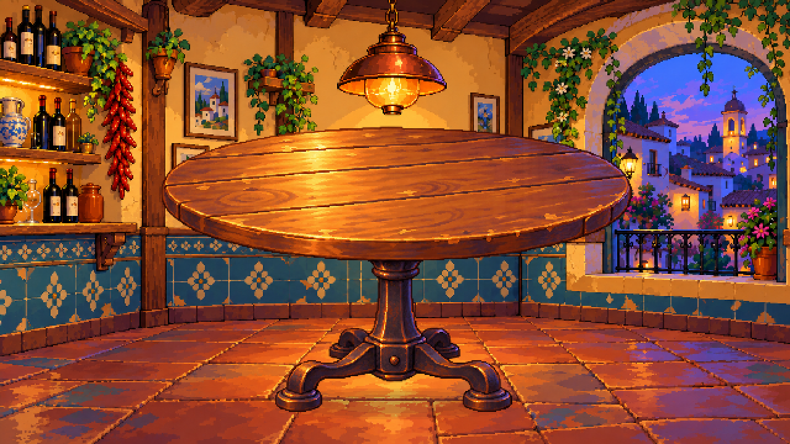

# Mesa redonda independiente

**Descartada por Ivan R por perspectiva incorrecta.** El objeto se generó con una cámara incompatible con el fondo y el asistente no lo detectó antes de presentarlo. Se conserva como prueba fallida. La [revisión v02](../mesa-redonda-v02/README.md) parte de una composición conjunta antes de separar piezas.

23 de octubre de 2026. Creada a petición de Ivan R para comprobar si el lenguaje visual del fondo v02 puede trasladarse a otros elementos. Ivan R ha valorado positivamente ese fondo; la mesa y su montaje siguen pendientes de valoración. No se atribuye esa valoración a Ivan S.



## Recursos

- [mesa.png](mesa.png): 384×235, RGBA con transparencia real. Tablero vacío para añadir platos, tapas y manos por separado.
- [mesa.aseprite](mesa.aseprite): original editable RGB con capas `pedestal` y `tablero`.
- [mesa.json](mesa.json): tamaño, recorte de la fuente, posición provisional y separación de capas.
- [montaje.png](montaje.png): composición a 640×360 con el fondo v02, sin modificar ese fondo.
- [montaje-2x.png](montaje-2x.png): ampliación exacta con nearest a 1280×720.
- [montaje.aseprite](montaje.aseprite): fondo, sombra de contacto, pedestal y tablero en cuatro capas independientes.
- [Fuente generada con transparencia](fuentes/mesa-generada.png), [prompt](fuentes/prompt.txt), [preparación reproducible](preparar.py) y [registro MCP](produccion-mcp.json).

## Coherencia con el fondo

Se proporcionaron como referencias el fondo v02 para iluminación, materiales y acabado, y el concepto inicial para la forma y función de la mesa. El tablero mantiene madera cálida con volumen, borde redondeado y reflejos; el pie central oscuro incorpora tonos cálidos y sombras violáceas. Se evita imponer una paleta pequeña o eliminar el modelado de luz.

La mesa es redonda en perspectiva poco profunda, con pie central para dejar espacio a las piernas de cinco personas. El tamaño de esta primera prueba y su posición `(128,100)` en el lienzo 640×360 son provisionales: se revisarán al colocar sillas y personajes.

El montaje es una composición de los archivos separados realizada en Aseprite; no una regeneración de una imagen completa con la mesa pintada sobre el escenario. Se añade una sombra de contacto en su propia capa para apoyar el pie en el suelo.

## Producción y comprobaciones

La imagen base se creó con la herramienta integrada de generación de imágenes solicitando alfa. Aseprite MCP limpia píxeles de alfa inferior a 16, recorta márgenes sobrantes, ajusta con nearest, organiza las capas y exporta en RGB/RGBA sin cuantización de paleta. Python coordina MCP y lee las imágenes con Pillow para verificar; no dibuja los recursos.

Se comprobó que el PNG de mesa conserva zonas transparentes y opacas, incluidas las cuatro esquinas transparentes. El montaje es opaco y la ampliación reproduce cada píxel en un bloque 2×2 idéntico. Se inspeccionaron visualmente mesa y montaje. Las seis llamadas MCP y los originales permiten repetir y revisar el resultado.

La división entre tablero y pedestal usa inicialmente la fila 113 de la celda. Es una separación para esta pose estática, no un sistema general de superposición de cuerpos y brazos. Habrá que ajustarla con las plazas delanteras/traseras si las poses lo requieren. No hay todavía tapas, sillas, personajes ni animaciones nuevos en este recurso.

## Reproducir

Con el laboratorio y `.mcp.json` locales configurados, desde la raíz:

```powershell
& '.\aseprite-mcp\.venv\Scripts\python.exe' '.\arte\objetos\mesa-redonda-v01\preparar.py'
```
