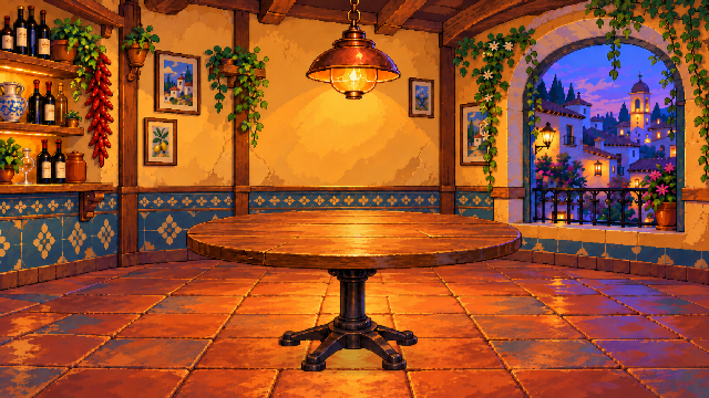

# Mesa v02: resolver la cámara antes de separar recursos

23 de octubre de 2026. Revisión tras el rechazo explícito de Ivan R de la mesa v01 por su perspectiva. La nueva composición y sus piezas están pendientes de valoración; no se registra aprobación de Ivan R ni de Ivan S.



## Fallo de la mesa anterior

Se generó un objeto aislado y se colocó en un escenario con otra cámara. Comprobar colores, transparencia y dimensiones no detectaba ese fallo. El asistente presentó el montaje sin revisar suficientemente horizonte, proporciones y apoyos.

Al prolongar dos juntas de profundidad del suelo del fondo anterior, su intersección aproximada queda en `(337,215)` sobre el lienzo 640×360. El tablero mostraba su cara superior en torno a `y=102–211`, por encima de ese horizonte indicativo. Un tablero horizontal visto desde esa cámara no puede presentar así la cara superior. El apoyo en el suelo se había resuelto alargando visualmente el conjunto.

La estimación se basa en lectura manual de juntas de una ilustración, no en una calibración exacta. Los puntos utilizados y el cálculo están en [revision-perspectiva.json](revision-perspectiva.json). Sirven para identificar una incompatibilidad grande, no para demostrar precisión fotográfica de todas las líneas.

## Proceso revisado

1. Crear una composición conjunta de habitación y mesa, conservando el lenguaje visual del fondo v02 y ajustando también la cámara/juntas del suelo.
2. Revisar el tablero respecto al horizonte, proporción tablero/pie, contacto y espacio circundante antes de separar objetos.
3. Obtener un fondo limpio y una extracción transparente con el mismo encuadre completo. La extracción generativa no es una máscara matemáticamente idéntica; se inspecciona su recomposición.
4. Preparar todos los archivos a 640×360 juntos. Recortar la mesa con coordenadas fijas y recomponerla en el mismo lugar, sin escalarla o recolocarla de forma independiente.

En la revisión, las juntas elegidas dan una intersección aproximada en `(344,155)` y la cara superior de la mesa está en torno a `y=189–244`, por debajo. Se ha revisado el montaje recombinado a 640×360, la proporción del apoyo y el contacto. Es una corrección del planteamiento y una nueva propuesta visual, no una aprobación atribuida al usuario.

**El fondo del montaje tiene la cámara revisada.** No es el PNG anterior sin cambios. La versión de fondo v02 se conserva como referencia de diseño/materiales; colocar esta mesa sobre otro fondo exige comprobar otra vez la cámara. El color común no garantiza perspectiva común.

## Recursos

- [montaje.png](montaje.png) / [montaje-2x.png](montaje-2x.png): composición real de las piezas a 640×360 y ampliación nearest a 1280×720.
- [montaje.aseprite](montaje.aseprite): fondo con cámara revisada, sombra de contacto, pedestal y tablero.
- [mesa.png](mesa.png) / [mesa.aseprite](mesa.aseprite): recurso transparente 312×156, posición `(164,186)` en este escenario. Dos capas, separadas provisionalmente por la fila de escena 244.
- [fondo-camara.png](fondo-camara.png) / [fondo-camara.aseprite](fondo-camara.aseprite): fondo limpio preparado desde la composición nueva.
- [referencia.png](referencia.png) / [referencia.aseprite](referencia.aseprite): composición generada inicial, antes de separar.
- [mesa.json](mesa.json), [preparar.py](preparar.py), [produccion-mcp.json](produccion-mcp.json): coordenadas, preparación y validación técnica reproducibles.
- [Fuentes y prompts](fuentes/): diseño conjunto, retirada de mesa y extracción alineada.

Las imágenes proceden de generación integrada y las operaciones de tamaño, separación, montaje y exportación se ejecutan mediante Aseprite MCP, en RGB y sin reducción de paleta. La sombra de contacto del montaje es una capa independiente programada. No se han creado personajes, sillas ni comida en esta revisión.

## Qué se ha comprobado

Se inspeccionaron el montaje real, el fondo y el PNG transparente. El script verifica alfa, esquinas transparentes, dimensiones, modo RGB, opacidad del montaje y todos los bloques de la ampliación 2×. Se ejecutan ocho llamadas MCP. Las comprobaciones técnicas y la revisión manual de perspectiva se documentan por separado; ninguna implica aceptación artística del equipo.

Con el laboratorio local configurado, reproducir desde la raíz:

```powershell
& '.\aseprite-mcp\.venv\Scripts\python.exe' '.\arte\objetos\mesa-redonda-v02\preparar.py'
```

Antes de detallar nuevos elementos, verificar también una figura/silla de escala y las cinco plazas alrededor de la mesa. El siguiente recurso no debe recibir una cámara distinta por generarse aislado.
