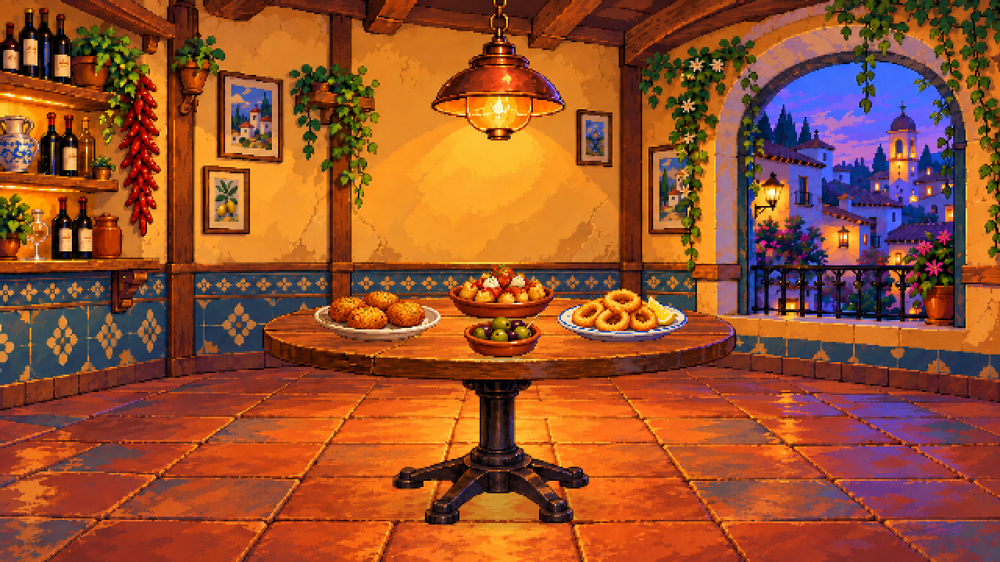

# Cuatro tapas como recursos independientes

23 de octubre de 2026. A petición de Ivan R para demostrar la continuidad del proceso añadiendo croquetas, patatas bravas, calamares y aceitunas sobre la mesa. Esta entrega no presupone aprobación del resultado ni de la revisión de mesa previa.



## Resultado y archivos

El montaje se realiza sobre `mesa-redonda-v02/montaje.aseprite`, conservando sus cuatro capas. Se añaden cuatro capas independientes, una por tapa, con ocho capas totales. La habitación y la mesa no se sustituyen por el fondo que pueda haber modificado el generador al crear la referencia.

| Tapa | PNG transparente | Original editable | Tamaño con sombra y margen | Posición en escena |
| --- | --- | --- | --- | --- |
| Croquetas | [croquetas.png](croquetas.png) | [croquetas.aseprite](croquetas.aseprite) | 86×41 | 198,184 |
| Patatas bravas | [bravas.png](bravas.png) | [bravas.aseprite](bravas.aseprite) | 72×44 | 284,166 |
| Calamares con limón | [calamares.png](calamares.png) | [calamares.aseprite](calamares.aseprite) | 88×43 | 354,182 |
| Aceitunas | [aceitunas.png](aceitunas.png) | [aceitunas.aseprite](aceitunas.aseprite) | 54×37 | 294,198 |

- [montaje.png](montaje.png): escena a 640×360.
- [montaje-2x.png](montaje-2x.png): ampliación exacta nearest a 1280×720.
- [montaje.aseprite](montaje.aseprite): composición por capas, con los platos ocultables por separado.
- [sin-aceitunas.png](sin-aceitunas.png): prueba de retirada de una capa sin reconstruir el resto.
- [tapas.json](tapas.json): recortes, tamaños y coordenadas.
- [Fuentes y prompts](fuentes/), [preparación reproducible](preparar.py) y [registro MCP](produccion-mcp.json).

Cada original individual tiene dos capas: sombra y plato con comida. En el montaje se combinan ambas por tapa, para que ocultar una retire también su sombra. Los bocados individuales no están separados; para animar consumo habría que preparar esos recursos o variantes del contenido.

## Método real y límite observado

Se generó primero una referencia de la mesa con los cuatro platos, solicitando la misma cámara, tamaño de mesa, bases apoyadas y platos elípticos en perspectiva. Después se hicieron cuatro extracciones transparentes, una por recurso. Son cinco llamadas a la herramienta integrada de generación de imágenes.

**El generador no mantuvo el encuadre pedido en las primeras extracciones.** Amplió y recentró los platos. Se detectó antes de montar; se recortaron por su alfa y se ajustaron a los tamaños/posiciones leídos en la referencia conjunta, con proporciones prácticamente iguales y sin introducir otra cámara. Los dos últimos prompts ya pedían un objeto aislado para ajustar explícitamente. Las extracciones son interpretaciones generativas, no máscaras pixel-perfect de la referencia.

Aseprite MCP limpia alfa residual (menos de 16 transparente, desde 240 opaco), prepara cada imagen con nearest y crea la sombra de contacto como capa separada. Conserva RGB y los tonos de volumen, sin cuantización de paleta. La recomposición se hace sobre el archivo original de la mesa, utilizando las cuatro tapas separadas. Python coordina MCP y lee píxeles para verificar; la preparación de imágenes se ejecuta en Aseprite.

## Revisión y comprobaciones

Se inspeccionaron el montaje a 640×360 y a 2×, la posición de las bases dentro del tablero y la lectura de platos/ingredientes. Los calamares mantienen anillos y limón, las bravas salsa roja y alioli, y las aceitunas tonos verdes/oscuros. La elección generada para las croquetas es redondeada; no se afirma que sean cilindros alargados ni se da por fijada su forma para producción.

Se comprobó técnicamente alfa transparente/opaco y esquinas transparentes en los cuatro PNG, ocho capas en escena, tamaño, opacidad y ampliación 2× exacta. Comparando todos los píxeles con la escena original, los 7177 píxeles modificados se limitan a los rectángulos de los platos. Al ocultar aceitunas, cambian únicamente 1135 píxeles de su zona. El resto permanece idéntico. Las nueve llamadas MCP y sus resultados se registran en `produccion-mcp.json`.

Estas comprobaciones no certifican por sí mismas calidad artística o exactitud proyectiva; la revisión visual y la valoración del equipo siguen siendo necesarias.

## Reproducir

Desde la raíz y con el laboratorio y `.mcp.json` configurados:

```powershell
& '.\aseprite-mcp\.venv\Scripts\python.exe' '.\arte\objetos\tapas-v01\preparar.py'
```

Se reutilizan las fuentes guardadas. La preparación no ejecuta nuevas generaciones de imagen ni modifica los archivos de la mesa original.
