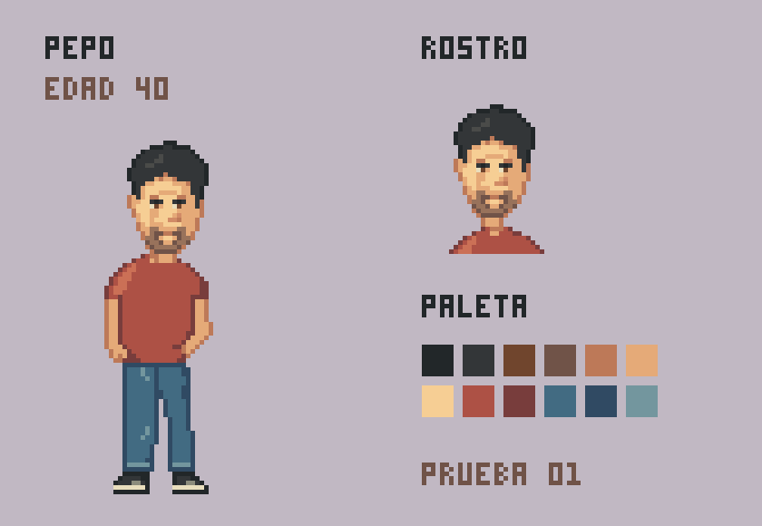

# Pepo · ficha visual de prueba 01

**Revisión posterior:** Ivan R señaló la falta de vistas y la escasa legibilidad de la nariz. Ver [v02: frontal, tres cuartos, perfil y espalda con cara revisada](../pepo-v02/README.md). Esta versión se conserva como historial.

Ejemplo solicitado por Ivan R el 24 de octubre de 2026. Es una propuesta de personaje reutilizable, pendiente de valoración; no fija el estilo del juego ni constituye aprobación de Ivan S.



## Rasgos indicados por Ivan R

- Nombre: Pepo; español; 40 años.
- Vaqueros y camiseta.
- Pelo negro, ojos marrones y algo de barba.
- Pixel art similar al ensayo anterior, con algo más de detalle.

## Propuesta visual de esta versión

Pose frontal relajada, pelo corto con un mechón irregular, barba corta, camiseta teja lisa, vaqueros azules y zapatillas oscuras con suela crema. Un brazo cae junto al cuerpo y la otra mano descansa junto al bolsillo. Colores, complexión, peinado concreto y calzado son propuestas del asistente.

La figura ocupa 24×78 píxeles dentro de un lienzo transparente de 64×88. Hay 18 colores opacos y alfa binario. La ficha muestra una selección de la paleta; la definición completa está en [pepo.px.js](pepo.px.js). Se dibuja directamente a resolución nativa mediante claude-pxl. Las imágenes de presentación amplían los píxeles 5×, sin suavizado.

## Reglas provisionales para reutilizarlo

| Aspecto | Base propuesta |
| --- | --- |
| Identidad | Conservar el mechón, la forma de la cara y la barba corta al cambiar de expresión. |
| Ropa | Camiseta lisa teja y vaqueros azules; cambios de vestuario serían variantes explícitas. |
| Color | Pelo `#222729`, `#333638`, `#4a4b49`; iris `#70452d`; camiseta `#ad5145`, `#783d3c`, `#cb7056`; vaqueros `#426b82`, `#304a63`, `#73969e`. |
| Bordes | Oscuros en pelo y zapatos; sombras de color en piel y ropa. No cerrar cada articulación con un contorno independiente. |
| Detalle | Mechones, cejas, iris, nariz y barba legibles; pliegues escasos y manchas de color amplias. Evitar texturas aleatorias. |
| Registro | Lienzo 64×88; suelas terminan en y=83. Mantener ese apoyo entre fotogramas. |
| Organización | Tres capas: cabeza, camiseta y brazos, vaqueros y zapatillas. Al animar habrá que separar y redibujar las partes necesarias. |

Esta ficha todavía no define perfiles, espalda, expresiones alternativas ni animaciones. Antes de ampliar el repertorio, validar este diseño y dibujar una segunda acción manteniendo sus proporciones. Para el gesto de pago, revisar la subida del codo, las longitudes de ambos segmentos y el agarre, según lo aprendido en [el ensayo anterior](../../pruebas/pxl-estilo-v02/README.md).

## Archivos y revisión

- [PNG nativo transparente](out/sprites/pepo.png).
- [Original con capas para Aseprite](out/sprites/pepo.aseprite).
- [Personaje ampliado](out/share/personaje.png) y [retrato](out/share/retrato.png).
- [Fuente reproducible](pepo.px.js).

Se revisó la ficha exportada: unión de cabeza y cuello, separación de piernas, silueta de brazos y lectura de la cara. La comprobación técnica confirma tamaño, colores y alfa. `pxl check` no informa de advertencias; marca esquinas en el mechón, borde de camiseta y puño del vaquero, conservadas como cambios angulosos de silueta. Esto no acredita aprobación artística ni demuestra por sí solo que el flujo sea eficiente.

Primera pasada del dibujo y una corrección localizada de camiseta y texto. Sin servicios adicionales de IA; no se ha medido el consumo de tokens. Reproducción desde la raíz, con la herramienta local ya instalada:

```powershell
node deps/claude-pxl/bin/pxl.js build arte/personajes/pepo-v01/pepo.px.js --only pepo,retrato,ficha,personaje --aseprite --share 5
```
