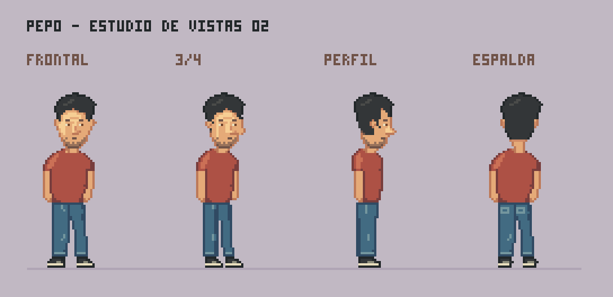
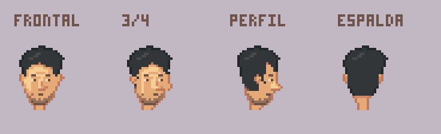

# Pepo v02 · cuatro vistas y revisión de la cara

24 de octubre de 2026. Ivan R señaló que la primera ficha no incluía otras vistas y que la cara resultaba extraña, con una nariz difícil de distinguir. Esta revisión responde a ambas observaciones; el diseño sigue pendiente de valoración.



## Qué cambia

- Cuatro vistas de cuerpo entero: frontal, tres cuartos hacia la derecha, perfil derecho y espalda. Se dibujan formas específicas para cada vista, incluidas mangas, manos, vaqueros y zapatillas.
- Nariz con puente y base separados de la barba. En perfil sobresale de la silueta y permite comparar frente, nariz y barbilla.
- Boca reducida a una marca sencilla; se elimina el aro claro rodeado de barba que parecía un hueco.
- Barba corta concentrada en mandíbula y mentón, con manchas abiertas. Se mantienen pelo negro y ojos marrones.
- Postura de referencia con brazos bajos; camiseta teja, vaqueros azules y zapatillas de la propuesta anterior.
- Espalda con nuca de pelo corto, cuello posterior y bolsillos traseros.



## Base provisional para reutilizarlo

Los rasgos pedidos por Ivan R siguen siendo: español, 40 años, camiseta y vaqueros, pelo negro, ojos marrones y algo de barba. El color de camiseta, el calzado, la complexión y el peinado concreto son propuestas, no decisiones aprobadas.

Cada vista usa un lienzo de **64×88**; la figura empieza en **y=6** y termina en **y=83**, para una altura de **78 píxeles**. Mantener la línea de apoyo y las alturas de cabeza, cuello, cintura y suelas al añadir acciones. La anchura cambia con la orientación. El perfil superpone las piernas y los brazos lejanos: no representa una pose de marcha.

Las tres capas editables son cabeza, camiseta y brazos, vaqueros y zapatillas. Son originales estáticos de referencia; para animarlos habrá que separar o redibujar las partes que se muevan. Todavía faltan expresiones, poses sentadas y acciones. Estas cuatro vistas no son fotogramas suficientes para una animación de giro.

## Archivos

- [Frontal PNG](out/sprites/frontal.png) · [Aseprite](out/sprites/frontal.aseprite).
- [Tres cuartos PNG](out/sprites/tres_cuartos.png) · [Aseprite](out/sprites/tres_cuartos.aseprite).
- [Perfil PNG](out/sprites/perfil.png) · [Aseprite](out/sprites/perfil.aseprite).
- [Espalda PNG](out/sprites/espalda.png) · [Aseprite](out/sprites/espalda.aseprite).
- [Hoja de sprites](out/pepo_vistas.png) · [Metadatos](out/pepo_vistas.json).
- [Fuente del dibujo y paleta](pepo.px.js).

Se conserva [v01](../pepo-v01/README.md) para comparar el diseño anterior. No se ha sustituido silenciosamente por la revisión.

## Revisión y reproducción

Se revisaron las láminas exportadas ampliadas y a tamaño nativo: nariz, boca, nuca, proporciones y apoyo. La comprobación técnica confirma cuatro lienzos iguales, alfa binario y los mismos límites verticales. `pxl check` no informa de advertencias; sus avisos visuales de esquinas corresponden al mechón, pliegues y bordes de ropa y calzado, conservados como cambios angulosos de forma. No valida por sí solo calidad artística ni semejanza entre vistas.

Primera pasada de cuatro vistas y una corrección localizada de nuca y talones; sin servicios adicionales de IA. No se ha medido el consumo de tokens. Dibujo nativo mediante claude-pxl, sin reducción de ilustraciones. Presentación ampliada 4× sin suavizado.

```powershell
node deps/claude-pxl/bin/pxl.js build arte/personajes/pepo-v02/pepo.px.js --only frontal,tres_cuartos,perfil,espalda,vistas,caras,pepo_vistas --aseprite --share 4
```
