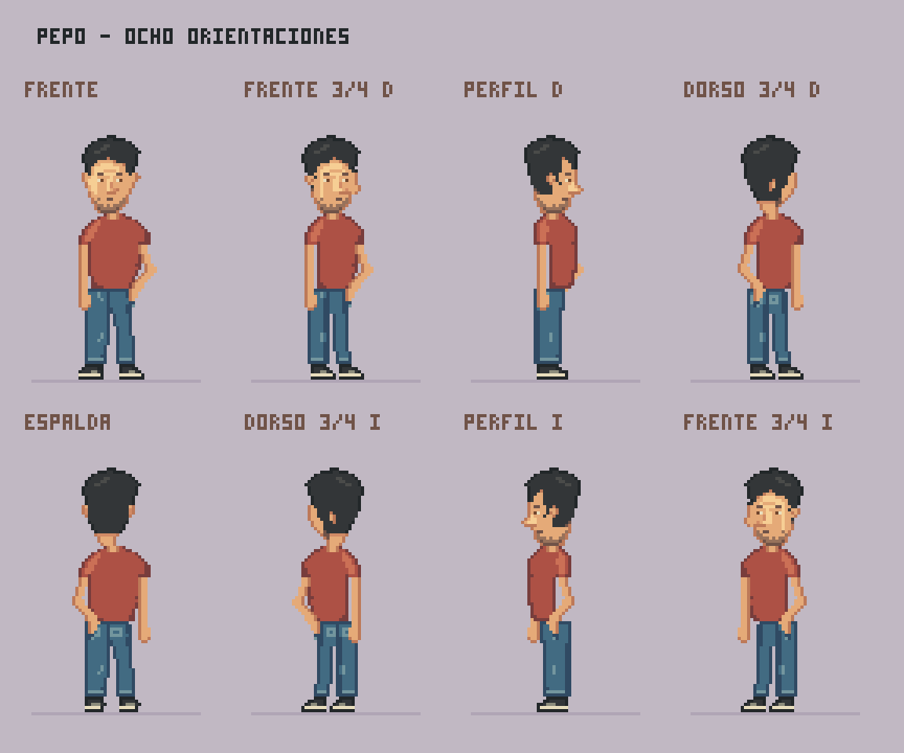
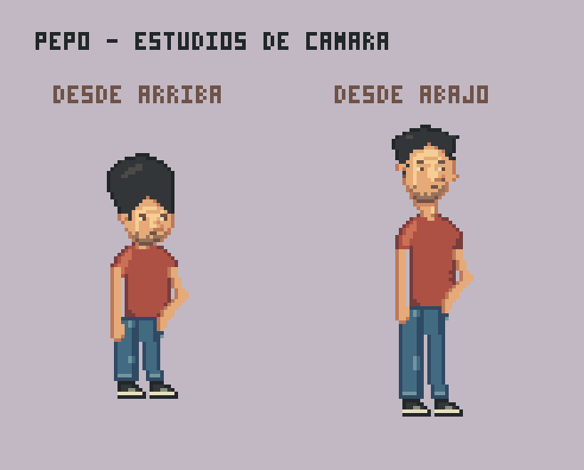

# Pepo v03 · postura, ocho orientaciones y cámaras

Ivan R señaló que v02 parecía inclinado y tenía brazos cortos; propuso una mano en el bolsillo y pidió ocho orientaciones, además de vistas desde arriba y abajo. Esta revisión conserva los rasgos pedidos y sigue pendiente de valoración artística.



## Postura revisada

- Cabeza, cuello, camiseta y pelvis se recolocan respecto a un eje común alrededor de x=32. En v02 las piezas tenían desplazamientos distintos.
- El brazo libre termina por debajo de la cintura, junto a la parte superior del muslo.
- La mano izquierda anatómica entra en el bolsillo delantero. Se prolonga el antebrazo hasta esa entrada; no se deja la mano apoyada sobre la cintura.
- Al generar las orientaciones opuestas se reutilizan bases reflejadas, pero se cambia antes la configuración de los brazos para conservar la misma mano en el bolsillo. No son ocho dibujos completamente independientes.

## Ocho orientaciones horizontales

La lámina sigue el giro: frente, frente tres cuartos derecho, perfil derecho, dorso tres cuartos derecho, espalda, dorso tres cuartos izquierdo, perfil izquierdo y frente tres cuartos izquierdo. Es una referencia de ocho direcciones aproximadas, no una rotación 3D calibrada ni una animación de giro terminada.

Los ocho PNG tienen lienzo 64×88 y figura de 78 píxeles de alto, desde y=6 hasta y=83. Las vistas conservan la misma línea de apoyo. El ancho cambia con la orientación y la postura del codo. En perfil hay partes lejanas ocultas por el cuerpo.

## Estudios desde arriba y abajo



Se incluyen **dos estudios adicionales de tres cuartos**, no otras ocho vistas por elevación:

- **Picado:** coronilla más visible, cara comprimida y reducción de longitud aparente de torso y piernas.
- **Contrapicado:** menos frente visible, más parte inferior de nariz y mentón, y proporciones proyectadas más alargadas.

Estos dos sprites usan lienzo 64×96 y no comparten el tamaño proyectado de las vistas horizontales. Son propuestas aproximadas: falta fijar la cámara del juego y comprobarlas junto al escenario y una mesa antes de usarlas en producción. No se han asignado grados exactos a los ángulos.

## Archivos

- [Fuente reproducible y paleta](pepo.px.js).
- [PNG y Aseprite de cada orientación](out/sprites/).
- [Hoja de ocho sprites](out/pepo_vistas.png) y [metadatos](out/pepo_vistas.json).
- [Frontal ampliado](out/share/postura.png).
- Historial: [v01](../pepo-v01/README.md), [v02](../pepo-v02/README.md).

Las capas separan cabeza, camiseta, piernas y los brazos cuando son visibles. Se mantiene el dibujo nativo con claude-pxl; las ampliaciones de presentación son 4× sin suavizado. No hay servicios adicionales de IA.

## Revisión

Se revisaron las láminas y se hicieron dos pasadas: en la segunda se bajó la mano hasta el bolsillo, se corrigió la colocación de brazos laterales y se reforzaron las diferencias de cámara. Las comprobaciones técnicas confirman alfa binario en diez sprites y lienzo, altura y apoyo comunes en las ocho orientaciones horizontales. `pxl check` no informa de advertencias; los avisos de esquinas se conservan en mechones, codos, pliegues y calzado. Esto no valida por sí solo calidad artística o perspectiva.

Todavía faltan expresiones y acciones; no se cierra ninguna decisión global del proyecto. No se ha medido consumo de tokens ni se da por demostrado un flujo de producción eficiente.

```powershell
node deps/claude-pxl/bin/pxl.js build arte/personajes/pepo-v03/pepo.px.js --only frontal,frente_d,perfil_d,dorso_d,espalda,dorso_i,perfil_i,frente_i,picado,contrapicado,vistas,camaras,postura,pepo_vistas --aseprite --share 4
```
