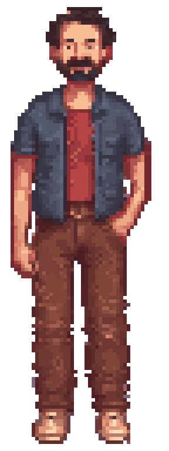

# Pepo · primer sprite maestro de prueba

**Estado:** ensayo técnico y visual del paso 2, 24 de octubre de 2026. Parte de la [ficha de referencia](../ficha-referencia-v01.md) y del [primer Pepo de ComfyUI](../../../pruebas/comfy-pepo-v01/README.md). Ni Ivan R ni Ivan S han aprobado este sprite como arte del juego. No se ha creado aún una animación.



## Archivos para evaluar

- [Sprite PNG transparente a 1×, 48×128](out/pepo.png).
- [Original Aseprite con cinco capas](out/pepo.aseprite): piernas, torso, brazo derecho anatómico, brazo izquierdo anatómico y cabeza. El brazo derecho es el que queda libre para la futura prueba de pago.
- [Vista en el fondo de taberna a 640×360, sin ampliar al personaje](out/escena-1x.png). Es una comprobación de escala y lectura; no fija su posición ni el escenario final.
- [Despiece de capas ampliado a 4×](out/capas-4x.png).
- [Generador](generar.py), [ensamblaje](ensamblar.lua), [verificación de capas en Aseprite](verificar.lua) y [metadatos](out/metadata.json).

## Método y revisión

La IA preparó un proceso **automático**: recorta el concepto, separa la figura del fondo, toma el color mediano de las celdas de una cuadrícula de 48×128, agrupa el color en 42 valores y clasifica las regiones visibles por anatomía. Añade una pequeña cantidad de tela oculta bajo las mangas para que las capas no empiecen con agujeros. Aseprite ensambla cinco capas editables. Ivan R no ha tenido que repintar el recurso.

Esto sigue siendo **conversión de una ilustración grande generada**, aunque la salida tenga una cuadrícula pequeña real, alfa binario y capas. No demuestra generación directa de pixel art nativo por IA ni garantiza que las capas puedan moverse sin corregir hombros y oclusiones. El original visual tenía muchos colores y textura; reducirlos no equivale por sí solo a un diseño de píxeles correcto.

**Revisión visual propia:** a 1× se distinguen pelo, barba, camiseta roja, sobrecamisa y posición general de los brazos. La figura tiene el carácter adulto del concepto, pero las piernas conservan ruido y pequeños salientes de la imagen original; el personaje se ve más sobrio y menos expresivo que la dirección «cute» explorada para la taberna. La unión de brazos todavía no se ha probado en movimiento. Es un candidato de prueba para evaluar la acción, no un recurso aceptado.

**Comprobación técnica:** Aseprite abrió el original y verificó un fotograma, tamaño 48×128 y las cinco capas en el orden previsto. El PNG exportado por Aseprite coincide exactamente con el PNG compuesto por el generador. El sprite visible tiene 3272 píxeles opacos y 42 colores RGB, datos de archivo sin valor de aprobación artística. La exportación adicional se conserva en [out/pepo-export.png](out/pepo-export.png) para comparar.

## Reproducir

En esta máquina se usaron Python 3.12, NumPy 2.4.6, OpenCV 5.0.0 y Pillow 12.2.0. Aseprite debe estar disponible localmente; sus binarios y los modelos no forman parte del repositorio.

```powershell
python arte/personajes/pepo/maestro-prueba-v01/generar.py
aseprite -b --script arte/personajes/pepo/maestro-prueba-v01/ensamblar.lua
aseprite -b arte/personajes/pepo/maestro-prueba-v01/out/pepo.aseprite --script arte/personajes/pepo/maestro-prueba-v01/verificar.lua
aseprite -b arte/personajes/pepo/maestro-prueba-v01/out/pepo.aseprite --save-as arte/personajes/pepo/maestro-prueba-v01/out/pepo-export.png
```

La prueba siguiente consiste en levantar el brazo derecho con una tarjeta **usando este mismo original** y comprobar a tamaño real que el hombro, la manga, el objeto y la mano no cambian de lado ni dejan huecos. Si el recurso exige repintar casi todo el fotograma, el método de conversión no habrá resuelto el objetivo de producción eficiente. La escala de 48×128 es provisional; tampoco se han elegido paleta, motor ni estilo final. Las decisiones del README siguen en 0/22.
