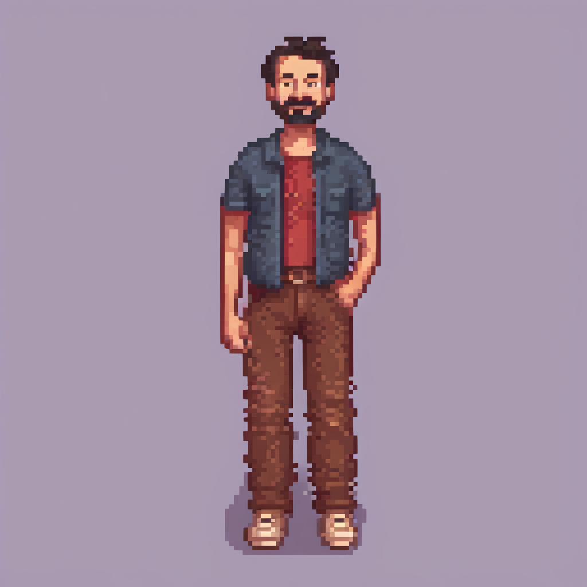
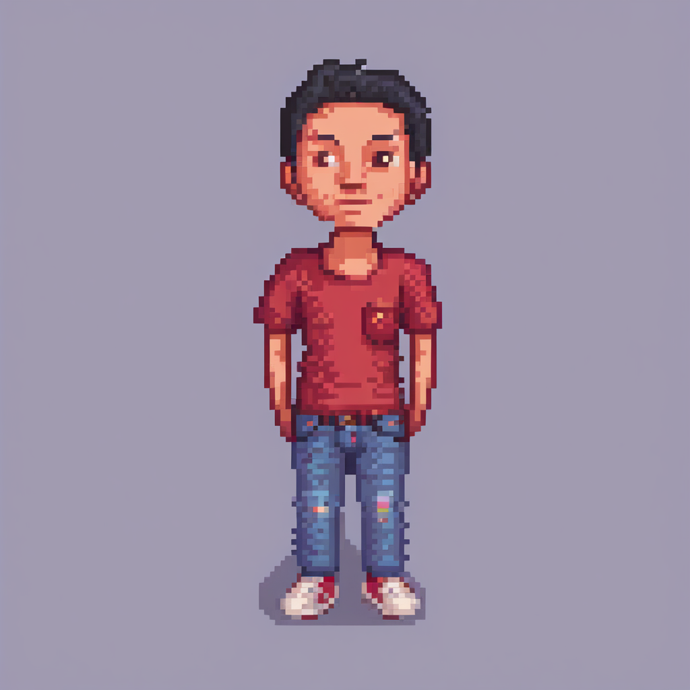

# Prueba local de ComfyUI: Pepo

24 de octubre de 2026. Ivan R pidió probar ComfyUI sin contratar herramientas ni servicios de IA. Se instalaron localmente ComfyUI y tres modelos descargables dentro de `deps/ComfyUI`, ignorado por Git. **No se contrató ningún servicio ni se llamó a una API de pago.** El servidor solo escuchó en `127.0.0.1:8188` durante la prueba y se detuvo al terminar.

## Resultados originales

**Intento 1.** Una figura adulta más equilibrada que Pepo v03, pero añadió una sobrecamisa, cambió los vaqueros azules por pantalones marrones y dibujó una barba completa. Parece una ilustración pixelada con bastante volumen. No cumple la ficha de Pepo ni está listo para animación.

**Valoración posterior de Ivan R:** «me gusta bastante el intento 1». Se tomó como referencia para el [ensayo de ocho orientaciones](../comfy-pepo-v02/README.md). Esa preferencia visual no confirma el cambio de vestuario de la ficha inicial ni aprueba un estilo definitivo para todo el juego.



**Intento 2.** Se reforzaron las instrucciones de camiseta única y vaqueros azules, y se prohibieron chaquetas y pantalones marrones. El modelo respondió a esos cambios y conservó una silueta recta, pero perdió casi toda la barba, parece más joven de 40 años y dejó las dos manos fuera del bolsillo. La imagen sigue teniendo muchos matices y sombreado irregular.



Los archivos son los **PNG de 1024×1024 obtenidos directamente del programa**, sin edición ni reducción. Tienen aproximadamente 62.803 y 76.766 colores opacos distintos. Bloques aparentes y una cuadrícula visual no equivalen a clusters nativos de píxeles controlados. La [ficha de Pixel Art XL](https://huggingface.co/nerijs/pixel-art-xl) propone reducir la imagen 8× mediante nearest; no se ha hecho aquí porque no convertiría automáticamente el resultado en el sprite nativo, consistente y editable que buscamos.

## Medición

| Aspecto | Intento 1 | Intento 2 |
| --- | ---: | ---: |
| Semilla | 24102026 | 24102027 |
| CFG | 5,5 | 6,5 |
| Pasos de muestreo | 20 | 20 |
| Tiempo desde encolado hasta PNG | 157,26 s | 130,11 s |
| Tamaño final | 1024×1024 | 1024×1024 |
| Servicios de IA de pago | 0 | 0 |
| Correcciones humanas del usuario | 0 | 0 |

Ambos usan SDXL base, Pixel Art XL con intensidad 1,2, el VAE FP16 corregido, `dpmpp_2m` y `karras`. La GPU detectada fue **GTX 1080 Ti, 11 GB**; PyTorch **2.7.1+cu126** funcionó con CUDA. ComfyUI **0.42.0**, revisión Git `7cebca52227c63b4180ceed448cbd7ad22903b6d`. La carga desde el disco y la activación de modelos forman parte de los tiempos medidos; no se confunden con los 43 segundos aproximados de muestreo por imagen. No se midieron tokens del asistente ni el tiempo humano total de configuración, así que no se ha demostrado eficiencia global.

Los dos resultados sugieren que la herramienta puede explorar **conceptos** con mejor anatomía que las cuadrículas anteriores, y que el texto permite corregir algunos atributos grandes. Dos muestras no bastan para validar consistencia entre vistas. En esta prueba no consiguió a la vez edad, barba, mano en el bolsillo y vestuario. No hay transparencia, original por capas ni animación. Por ahora no adoptamos ComfyUI como productor de sprites finales ni cerramos decisiones artísticas.

## Reproducir localmente

Los ejecutables, el entorno Python y los modelos no se suben al repositorio. Los archivos publicados son [workflows exactos](workflow-api.json), [segundo workflow](workflow-api-02.json), [catálogo de modelos y hashes](modelos.json), [descarga/verificación](instalar_modelos.py), [cliente local](generar.py), imágenes y JSON de resultados en `out/`.

1. Clonar [ComfyUI](https://github.com/Comfy-Org/ComfyUI) en `deps/ComfyUI` en la revisión registrada en `modelos.json`. Crear su entorno Python 3.12. Para NVIDIA serie 10, usar la variante CUDA 12.6 que [documenta el proyecto](https://github.com/Comfy-Org/ComfyUI#installing).
2. Instalar `torch==2.7.1+cu126`, `torchvision==0.22.1+cu126`, `torchaudio==2.7.1+cu126` y los requisitos del repositorio en ese entorno. La prueba utilizó `uv` y conservó esas tres versiones al instalar `requirements.txt`.
3. Desde la raíz, ejecutar `python arte/pruebas/comfy-pepo-v01/instalar_modelos.py`. Descarga o valida los tres archivos por tamaño y SHA-256, en el laboratorio ignorado por Git.
4. Arrancar el servidor sin nodos externos ni de pago:

```powershell
deps/ComfyUI/.venv/Scripts/python.exe deps/ComfyUI/main.py --listen 127.0.0.1 --port 8188 --offline --disable-all-custom-nodes --cache-none --fp16-unet --fp16-text-enc --fp32-vae --use-split-cross-attention --disable-dynamic-vram --reserve-vram 0.7
```

5. En otra terminal, enviar el workflow deseado mediante el cliente Python. Cada intento recibe su nombre para conservar imágenes anteriores:

```powershell
deps/ComfyUI/.venv/Scripts/python.exe arte/pruebas/comfy-pepo-v01/generar.py --workflow arte/pruebas/comfy-pepo-v01/workflow-api.json --name pepo-01
deps/ComfyUI/.venv/Scripts/python.exe arte/pruebas/comfy-pepo-v01/generar.py --workflow arte/pruebas/comfy-pepo-v01/workflow-api-02.json --name pepo-02
```

La primera instalación requiere varias descargas grandes y disco libre; las imágenes se generan localmente. Los archivos `out/*-request.json` guardan las solicitudes enviadas y `out/*-result.json` los tiempos y respuestas. Una nueva generación con la misma semilla y los mismos modelos debe conservar los parámetros, aunque la igualdad exacta de píxeles entre versiones de GPU o librerías no se ha comprobado.
