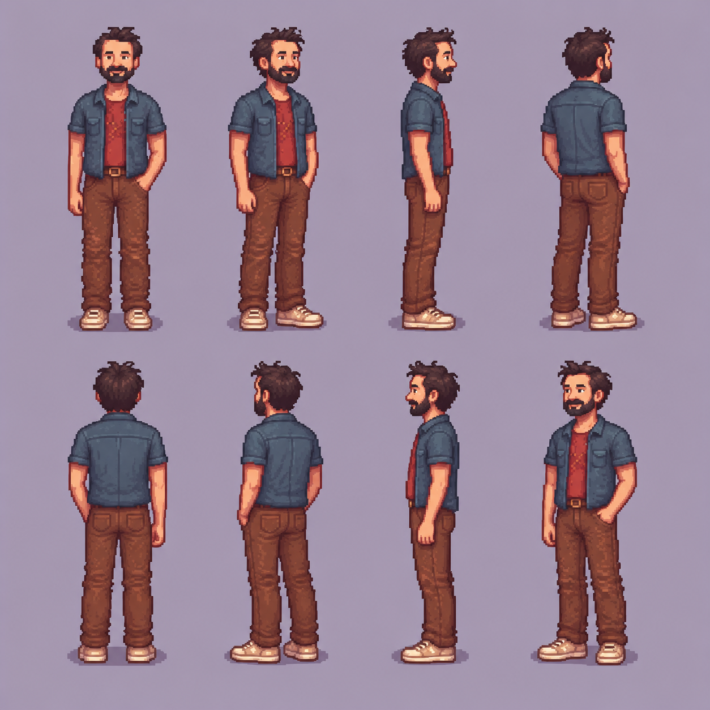

# Pepo: ensayo de ocho orientaciones

24 de octubre de 2026. Ivan R indicó que **le gusta bastante el primer Pepo generado con ComfyUI** y pidió intentar sus orientaciones. Esta valoración se refiere a esa imagen y sirve de referencia para el ensayo; no aprueba todavía la dirección artística global ni sustituye el acuerdo de Ivan S. Se conservó el vestuario **tal como aparece en ese intento** (sobrecamisa gris azulada, camiseta roja, pantalón marrón y zapatillas claras), aunque difiere de la ficha inicial de Pepo, que pedía camiseta y vaqueros. Queda pendiente decidir qué vestuario usar en el juego.

## Lámina obtenida

Orden, de izquierda a derecha: **frente, tres cuartos derecho, perfil derecho, tres cuartos trasero derecho**; debajo, **espalda, tres cuartos trasero izquierdo, perfil izquierdo y tres cuartos frontal izquierdo**. La imagen original de 1254×1254 se generó con la herramienta de imágenes incluida en este chat, usando como referencia [Pepo ComfyUI intento 1](../comfy-pepo-v01/out/pepo-01-9-0.png) y [este prompt](prompt-imagegen.txt). Se copió al repositorio sin modificarla. No se contrató ninguna IA adicional ni se usó una API de pago por separado; no se midieron límites de uso ni coste interno de la herramienta.

**Revisión visual:** las ocho siluetas describen giros reconocibles, las vistas de perfil muestran un solo ojo y las traseras no muestran la cara. Pelo, barba, prendas y colores se mantienen bastante próximos entre vistas. Hay pequeñas variaciones en tamaño, pies, manos, bolsillos, costuras y detalle de las caras; no se han comprobado ni corregido para animación. El brazo de la mano en el bolsillo cambia su lectura al girar. Es un **concepto de turnaround**, no ocho sprites listos para juego: no hay transparencia ni capas, los píxeles no siguen una cuadrícula de producción comprobada y las poses no comparten anclas verificadas. No usar la lámina como prueba de generación nativa de pixel art.

## Qué hizo ComfyUI local

Se intentó primero girar la imagen con las herramientas locales, sin servicio de pago. [Preparar workflows](preparar_workflows.py) copia la referencia sin alterarla a `deps/ComfyUI/input/` y crea ocho workflows de imagen a imagen. Solo se ejecutó el perfil derecho, con estos ajustes, porque no mostró suficiente control para lanzar los siete restantes:

| Prueba | Tiempo hasta PNG | Resultado visible |
| --- | ---: | --- |
| [Imagen a imagen, denoise 0,70](out/02-derecha-9-0.png) | 132,89 s | Conserva la figura y el vestuario aproximado, pero sigue de frente. |
| [Imagen a imagen, denoise 0,97](out/02-derecha-fuerte-9-0.png) | 124,90 s | Sigue de frente y cambia color de sobrecamisa y zapatos. |
| [Solo texto, desde ruido](out/02-derecha-texto-9-0.png) | 129,73 s | Consigue un perfil derecho claro, pero deriva en cara, ropa y fondo. |
| [Texto + IP-Adapter 0,65](out/02-derecha-ipadapter-9-0.png) | 223,36 s | Aproxima tres cuartos derecho; invierte los colores de las capas y cambia escala y zapatos. |
| [Texto + IP-Adapter 0,35](out/02-derecha-ipadapter-ligero-9-0.png) | 159,81 s | Gira hacia el lado contrario y pierde la camiseta roja. |

Los PNG de la tabla son salidas originales, no retoques. Sus workflows exactos y los JSON de solicitud y resultado están en [`workflows/`](workflows/) y [`out/`](out/). El complemento [ComfyUI_IPAdapter_plus](https://github.com/cubiq/ComfyUI_IPAdapter_plus) se clonó localmente en la revisión `a0f451a5113cf9becb0847b92884cb10cbdec0ef`. Se descargaron y comprobaron dos modelos públicos con el [manifiesto](modelos.json) y el [instalador](instalar_ipadapter.py); los archivos grandes y el código de la herramienta permanecen en `deps/`, fuera de Git. Tras la prueba se detuvo el servidor.

**Conclusión provisional:** para este ejemplo, el flujo básico de ComfyUI no logró girar y conservar el mismo personaje a la vez. La lámina de imagegen resuelve mejor la exploración visual de ocho vistas con una petición, pero todavía requeriría un método aparte para convertir cada vista en un sprite nativo, editable, alineado y animable. Esta comparación no mide tiempo humano total ni demuestra un proceso eficaz de producción. El contador de decisiones del juego permanece en **0/22**.
