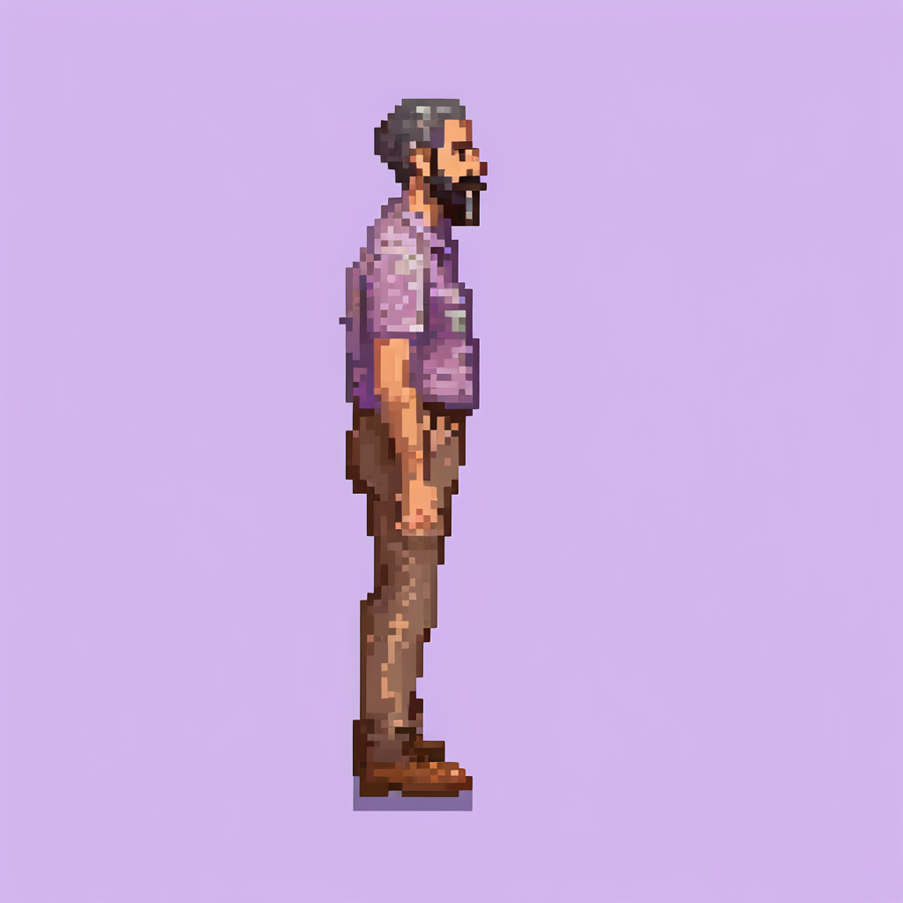

# Pepo: perfil con control estructural

24 de octubre de 2026. Tras el rechazo de la lámina de ocho orientaciones como recurso de juego, se hizo **una prueba acotada** para distinguir el control del ángulo del control de identidad. Se usó ComfyUI local con SDXL, Pixel Art XL, la referencia visual [Pepo intento 1](../comfy-pepo-v01/out/pepo-01-9-0.png), IP-Adapter y [ControlNet Canny SDXL](https://huggingface.co/xinsir/controlnet-canny-sdxl-1.0). No se llamó a ninguna API de pago ni se contrató otra IA.

## Resultado original

**Lo que sí funcionó:** el cuerpo y la cara están claramente de perfil derecho, a diferencia de la primera prueba de imagen a imagen que siguió de frente. La [guía de contornos](out/side-guide-canny.png) procede de un perfil generado antes con solo texto. Se conservan aproximadamente el pelo oscuro y la barba.

**Lo que falló:** la sobrecamisa gris azulada del Pepo preferido pasó a morado, desapareció la camiseta roja visible y las zapatillas claras se convirtieron en zapatos marrones. Tampoco existe una garantía de que el lado de la mano y el bolsillo se mantengan en más vistas o poses. Es una ilustración grande de apariencia pixelada, sin cuadrícula nativa comprobada, alfa ni capas. **No usar como sprite final ni como vista aprobada.**

El tiempo desde encolado hasta PNG fue **534,87 s** en la GTX 1080 Ti de 11 GB, con `--lowvram` y descarga de capas. Incluye carga de modelos y otras esperas; no es solo tiempo de muestreo. Una imagen no basta para afirmar que el método no puede funcionar con otros parámetros, pero este ajuste no ofrece aquí la consistencia ni la velocidad que necesitamos. No se lanzaron siete vistas adicionales.

## Reproducibilidad

- [Workflow exacto](workflow-api.json) y [solicitud/resultado](out/perfil-controlado-request.json) guardados en Git. La [guía](out/side-guide-canny.png) se creó con [este script](crear_guia.py) a partir del [perfil textual previo](../comfy-pepo-v02/out/02-derecha-texto-9-0.png), usando OpenCV Canny con desenfoque gaussiano y umbrales 80/160.
- ControlNet: archivo, revisión, tamaño y SHA-256 en [modelos.json](modelos.json), con [script de instalación](instalar_controlnet.py). Se instaló únicamente en `deps/ComfyUI/models/controlnet`, ignorado por Git. ComfyUI e IP-Adapter y los otros modelos están documentados en los ensayos [v01](../comfy-pepo-v01/README.md) y [v02](../comfy-pepo-v02/README.md).
- ComfyUI se ejecutó en localhost con `--offline --lowvram --fp16-unet --fp16-text-enc --fp32-vae --use-split-cross-attention --reserve-vram 0.7`; se detuvo al acabar.
- La guía fue copiada a `deps/ComfyUI/input/pepo-side-guide-canny.png` y la referencia a `deps/ComfyUI/input/pepo-comfy-orientaciones.png`; ambas son copias locales. El cliente [generar.py](../comfy-pepo-v01/generar.py) envió el workflow por la API local.

El resultado refuerza la [nueva investigación](../../../docs/leads-personajes-consistentes.md): controlar la silueta no fija por sí mismo prendas, identidad o manos. La siguiente prueba debe trabajar con un original y piezas canónicas, sin prometer que otro prompt lo arregle.
