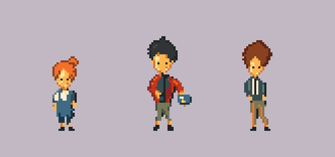
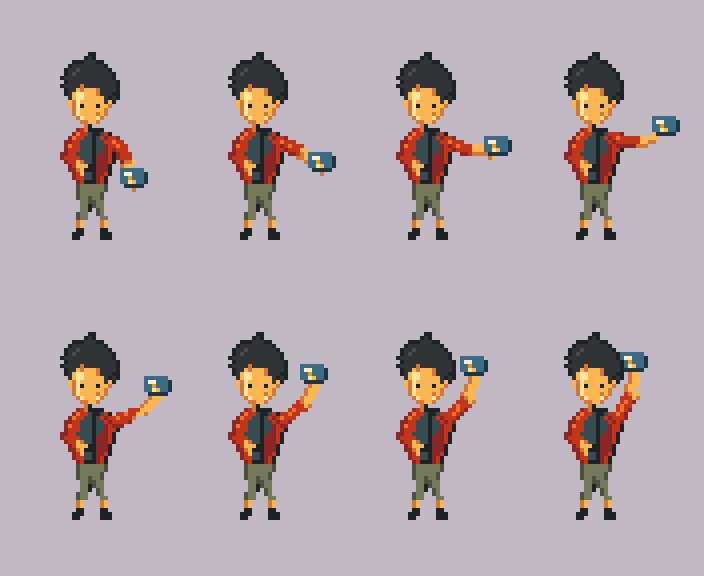

# Estudio de estilo v02: personajes pequeños en 2D

24 de octubre de 2026. Ivan R rechazó el aspecto de [pxl-pago-v01](../pxl-pago-v01/README.md): percibía demasiado volumen o apariencia 3D. Ha aportado una imagen de personajes pequeños como referencia para un nuevo intento. Esto no supone acuerdo de los dos integrantes sobre la dirección artística definitiva.



[Ver prueba animada de pago](out/share/animacion.gif) · [Ocho poses del gesto](out/share/poses.png) · [Fuente del dibujo](estilo.px.js)

## Revisión del brazo · 24 de octubre de 2026

Ivan R rechazó el brazo del primer intento. En esa versión el codo apenas se movía y el antebrazo se alargaba al levantar la tarjeta. La revisión mueve el codo junto con la manga y mantiene los dos segmentos en torno a 6–7 píxeles entre sus puntos de referencia. Se ha redibujado cada pose sobre la cuadrícula con claude-pxl, sin girar piezas rasterizadas ni contornear cada articulación.

Ocho poses sustituyen a las cinco anteriores. El antebrazo tiene tres píxeles de grosor en la mayor parte del recorrido, se une a la manga y termina en el agarre de la tarjeta. La subida y la bajada recorren esas poses a 12 fps, con pausas en reposo y arriba. Es una revisión localizada: el torso, la cabeza y las piernas siguen fijos. No equivale a una animación expresiva de cuerpo entero ni está aprobada por Ivan R.



## Qué se ha intentado trasladar

El análisis con `pxl study` identifica la imagen aportada como una ampliación 3×: cuadrícula nativa de 187×100, cinco grupos con personajes de unos 43–54 píxeles de alto y aproximadamente 10–12 colores por grupo. Son mediciones automáticas orientativas, complementadas con revisión visual.

Esta prueba usa cabeza grande, caras mínimas, masas oscuras en pelo y ropa, sombras por manchas, bordes de color abiertos y pies pequeños. Se abandona el sombreado continuo de los brazos y piernas del ensayo anterior. Los tres diseños son nuevos: no se han importado ni calcado los sprites de la referencia. Los nombres Nora, Inés y Teo son etiquetas del experimento, no personajes confirmados del juego.

Se ha dibujado directamente sobre cuadrícula mediante claude-pxl. No hay modelo 3D, degradados, cápsulas sombreadas, iluminación automática, contorno automático por piezas ni ilustración grande reducida. La paleta y el fondo neutro se inspiran en la referencia; no son acuerdos globales del proyecto.

## Recursos y comprobaciones

| Recurso | Resultado |
| --- | --- |
| Nora | Lienzo 36×56; figura en reposo de 22×47. 16 colores contando la tarjeta; 12 sin sus cuatro tonos propios. |
| Inés | Lienzo 32×56; figura de 13×37, 11 colores. |
| Teo | Lienzo 32×56; figura de 15×45, 11 colores. |
| Gesto | Ocho poses; ciclo de 36 fotogramas a 12 fps, 2,988 s exportados. |
| Original animado | Seis capas: cuerpo, brazo libre, brazo de pago, tarjeta, agarre y cabeza. |
| Lámina | 166×78 nativos; las ampliaciones de presentación usan nearest a 4×. |

Originales `.aseprite`, PNG y metadatos están en `out/sprites`, `out/anims` y `out/scenes`. [pago.aseprite](out/anims/pago.aseprite) conserva las capas. [verificacion.json](verificacion.json) registra la comparación exacta de la tira de animación después de abrir y exportar ese original con Aseprite. Los tres sprites usan alfa binario.

Se han revisado visualmente las ocho poses exportadas, la unión con el hombro y la trayectoria del codo. La verificación técnica comprueba alfa binario en las ocho poses y los otros dos personajes, y la igualdad exacta de los 36 fotogramas tras exportar el original desde Aseprite. `pxl check` señala dos esquinas en mechones de Inés, conservadas como puntas deliberadas. No comprueba aquí iluminación, altura o marcadores frontales por faltar esos metadatos; no acredita semejanza artística por sí solo.

**Valoración del asistente:** el codo ahora acompaña a la subida y desaparece el alargamiento extremo de la última pose anterior. La semejanza con la referencia sigue siendo parcial: los cuerpos tienen menos variedad de postura, Inés y Teo siguen estrechos y el gesto de pago mantiene el cuerpo fijo. Son limitaciones visibles; no se presenta como estilo replicado con éxito ni como arte aprobado. Falta la valoración de Ivan R sobre esta revisión.

## Reproducir

Misma herramienta local que v01: claude-pxl `e054b073b634026b9b0446ec7779cefeec9aef21`, Node 24.19.0. Desde la raíz del proyecto:

```powershell
./arte/pruebas/pxl-estilo-v02/reproducir.ps1
```

`-PxlRoot` permite otra ubicación de la herramienta. No utiliza servicios adicionales de IA. [verificar.py](verificar.py) solo inspecciona imágenes/exportaciones con Pillow y Aseprite del laboratorio; no dibuja.
