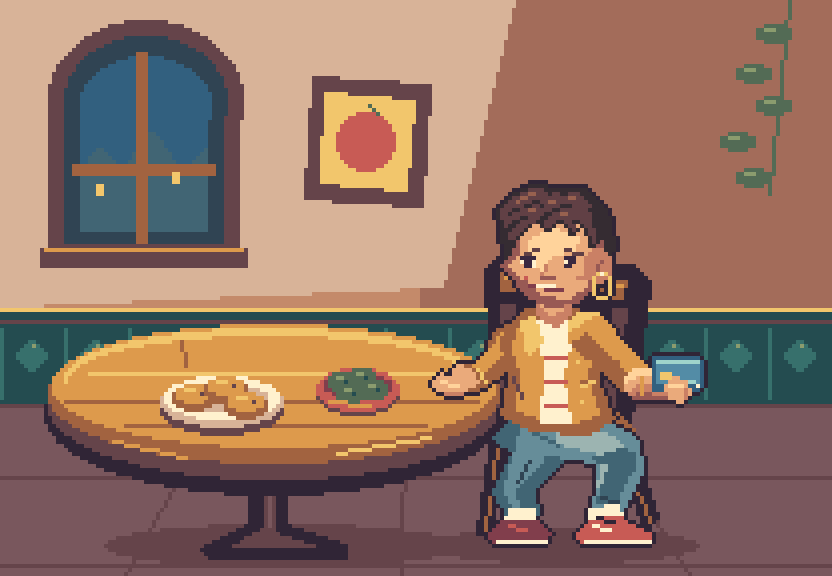

# Prueba de claude-pxl: ofrecer pagar

24 de octubre de 2026. Ensayo original solicitado por Ivan R. Dibujo producido por Codex con claude-pxl, directamente sobre cuadrícula nativa, sin importar una ilustración ni reducirla. La herramienta funciona localmente; no se ha contratado ni llamado a otro proveedor de IA.



## Probarlo

Abrir [index.html](index.html) en el navegador, después de descargar o clonar el repositorio. No necesita paquetes ni un servidor: el visor carga imágenes y JavaScript locales. La vista de archivos de GitHub no ejecuta este HTML; el GIF anterior sí permite compartir el resultado públicamente.

- **Ofrecer pago:** sube la mano y mantiene la oferta.
- **Bajar mano:** vuelve a reposo, también si se pulsa durante la subida.
- **Pausar** y la barra permiten revisar las siete poses.
- Vista aislada o con mesa y escala entera de 2× a 5×.

La viñeta aporta contexto de apoyo y escala. No sustituye el fondo v02 ni fija el estilo definitivo. Personaje y recursos son nuevos; no se han copiado sprites de juegos ni de los ejemplos de pxl.

## Entrega

| Recurso | Datos |
| --- | --- |
| Personaje | Lienzo nativo 96×112; siete poses del gesto. |
| Clips | Reposo, subir, sostener, bajar y un ciclo de demostración. |
| Ciclo | 36 fotogramas a 10 fps; 3,6 segundos. |
| Editables | Ocho capas: piernas, brazo apoyado, torso, cabeza, brazo de pago, tarjeta, agarre y contorno. |
| Contexto | 208×144; 31 colores visibles. Es el resultado de esta prueba, no una restricción global. |
| Objetos | Fondo, silla, mesa, croquetas, aceitunas y sombras separados. |

El [fuente del dibujo](pago.px.js) contiene todos los recursos. Los PNG de los clips y sus JSON están en `out/anims/`; la hoja con etiquetas está en [out/personaje.png](out/personaje.png) y [out/personaje.json](out/personaje.json). Hay originales `.aseprite` junto a cada recurso. El [original del gesto](out/anims/pago.aseprite) conserva las capas y fotogramas.

La tarjeta se coloca mediante el punto de unión `brazo.mano`; el agarre se dibuja por delante. El brazo se vuelve a rasterizar por pose, sin rotar un recorte. El contorno se calcula sobre la silueta compuesta y se exporta en su propia capa; al modificar una pose posteriormente habrá que actualizar también ese contorno.

## Resultado y límites

**Verificado:** producción nativa, clips separados, unión tarjeta/mano, exportación por capas y uso de los controles en el navegador. Los cinco originales animados se han abierto y reexportado con Aseprite: todos coinciden píxel por píxel con las tiras de pxl. Transparencia binaria y pies estables en los fotogramas exportados. Véase [verificacion.json](verificacion.json).

**Revisión visual del asistente:** pelo conectado a la cabeza, piernas con apoyos diferentes y sin anillos oscuros entre segmentos del brazo. El gesto se entiende, pero sigue siendo mecánico: el torso solo acompaña un píxel, la bajada reutiliza las poses de subida y falta más actuación en hombro, mano y expresión. La cara es bastante angular. Se propone como muestra para valorar, no como diseño aprobado o animación final.

Se han revisado poses aisladas, composición y controles de ofrecer, sostener, bajar, pausar, examinar una pose intermedia, cancelar desde esa pose y cambiar de vista/escala. El motor geométrico de perspectiva y los rigs 3D de pxl no se han utilizado aquí: esta prueba usa dibujo 2D con inclinación compartida de mesa y platos.

`pxl check` no emitió avisos, pero indicó que no ejecutó comprobaciones de luz, altura/pies ni marcador frontal por faltar esos metadatos. Las comprobaciones técnicas propias y la revisión visual se registran aparte; ese comando por sí solo no acredita la calidad de la escena.

**Eficiencia:** fuente reutilizable, dos revisiones principales del dibujo/composición y una revisión del uso de puntos de unión. Tres capturas con `shot`, tres construcciones finales con `build` y dos tandas de comprobación de los cinco originales con Aseprite, además de la revisión en navegador. No se ha instrumentado el tiempo total ni el consumo de tokens de esta tarea. No hay base para afirmar que sea más rápido o barato que otra alternativa. No se ha requerido retoque manual del usuario.

## Reproducir

Herramienta probada: [augusto-scarvalho/claude-pxl](https://github.com/augusto-scarvalho/claude-pxl), revisión `e054b073b634026b9b0446ec7779cefeec9aef21`, Node 24.19.0. La copia local está en `deps/claude-pxl`, ignorada por Git; no se registra globalmente como skill ni se modifica su motor.

Desde la raíz del proyecto, con Node 22.18 o posterior:

```powershell
git clone --depth 1 https://github.com/augusto-scarvalho/claude-pxl.git deps/claude-pxl
git -C deps/claude-pxl checkout e054b073b634026b9b0446ec7779cefeec9aef21
./arte/pruebas/pxl-pago-v01/reproducir.ps1
```

Si ya existe la copia, omitir el clon y comprobar la revisión. `-PxlRoot` permite indicar otra ubicación. `-Verificar` añade la comprobación con Aseprite y Pillow del laboratorio local; [verificar.py](verificar.py) solo inspecciona imágenes y originales, no dibuja. No hace falta Aseprite para ejecutar pxl ni usar el visor ya exportado.
